# pedmod: Pedigree Models

[](https://github.com/boennecd/pedmod/actions/workflows/R-CMD-check.yaml)
[](https://CRAN.R-project.org/package=pedmod)
[](https://cranlogs.r-pkg.org/)

Use pedmod to fit mixed probit models to binary outcomes in pedigree
data. The model for individual $j$ in family $i$ is

$$
\begin{aligned}
Y_{ij} \mid \epsilon_{ij} = e
  &\sim \text{Bin}(\Phi(\vec\beta^\top\vec x_{ij} + e), 1) \\
\vec\epsilon_i = (\epsilon_{i1}, \dots, \epsilon_{in_i})^\top &\sim
  N^{(n_i)}\left(\vec 0, \sum_{l = 1}^K\sigma_l^2 C_{il}
  \right)
\end{aligned}
$$

where $Y_{ij}$ is the binary outcome of interest for individual $j$ in
family/cluster $i$, $\vec x_{ij}$ is the individual’s known covariates,
$\Phi$ is the standard normal distribution’s CDF, and $\text{Bin}$
implies a binomial distribution such if $z\sim \text{Bin}(p, n)$ then
the density of $z$ is:

$$
f(z) = \begin{pmatrix} n \\ z \end{pmatrix}p^z(1 - p)^{n-z}
$$

A different and equivalent way of writing the model is as:

$$
\begin{aligned}
Y_{ij} \mid \epsilon_{ij} = e
  &= \begin{cases}
    1 & \vec\beta^\top\vec x_{ij} + e > 0 \\
    0 & \text{otherwise}
    \end{cases} \\
\vec\epsilon_i = (\epsilon_{i1}, \dots, \epsilon_{in_i})^\top &\sim
  N^{(n_i)}\left(\vec 0, I_{n_i} + \sum_{l = 1}^K\sigma_l^2 C_{il}
  \right)
\end{aligned}
$$

where $I_{n_i}$ is the $n_i$ dimensional identity matrix which comes
from the unshared/individual specific random effect. This effect is
always included. The models are commonly known as liability threshold
models or mixed probit models.

The matrices $C_{il}$ are known scale or correlation matrices where each
of the $l$’th types correspond to a type of effect. An arbitrary number
of such matrices can be passed to include e.g. a genetic effect, a
maternal effect, a paternal, an effect of a shared adult environment
etc. Usually, these matrices are correlation matrices as this simplifies
later interpretation and we will assume that all the matrices are
correlation matrices. A typical example is that $C_{il}$ is two times
the kinship matrix in which case we call:

$$
\frac{\sigma_l^2}{1 + \sum_{k = 1}^K\sigma_k^2}
$$

the heritability. That is, the proportion of the variance attributable
to the the $l$’th effect which in this case is the direct genetic
effect. The scale parameters, the variances $\sigma_k^2$, may be the
primary interest in an analysis. The scale in the model cannot be
identified. That is, an equivalent model is:

$$
\begin{aligned}
Y_{ij} \mid \epsilon_{ij} = e
  &= \begin{cases}
    1 & \sqrt\phi\vec\beta^\top\vec x_{ij} + e > 0 \\
    0 & \text{otherwise}
    \end{cases} \\
\vec\epsilon_i = (\epsilon_{i1}, \dots, \epsilon_{in_i})^\top &\sim
  N^{(n_i)}\left(\vec 0,
  \phi\left(I_{n_i} + \sum_{l = 1}^K\sigma_l^2 C_{il}\right)
  \right)
\end{aligned}
$$

for any $\phi > 0$. A common option other than $\phi = 1$ is to set
$\phi = (1 + \sum_{l = 1}^K \sigma_l^2)^{-1}$. This has the effect that

$$
\frac{\sigma_l^2}{1 + \sum_{k = 1}^K\sigma_k^2} = \phi\sigma_l^2
$$

is the proportion of variance attributable to the $l$’th effect
(assuming all $C_{il}$ matrices are correlation matrices). Moreover,
$\phi$ is the proportion of variance attributable to the individual
specific effect.

The parameterizations used in the package are $\phi = 1$ which we call
the direct parameterizations and $(1 + \sum_{l = 1}^K \sigma_l^2)^{-1}$
which we call the standardized parameterizations. The latter have the
advantage that it is easier to interpret as the scale parameters are the
proportion of variance attributable to each effect (assuming that only
correlation matrices are used) and the $\sqrt\phi\vec\beta$ are often
very close the estimate from a GLM (that is, the model without the other
random effects) when the covariates are unrelated to random effects that
are added to the model. The latter makes it easy to find starting
values.

For the above reason, two parameterization are used. For the direct
parameterization where $\phi = 1$, we work directly with $\vec\beta$,
and we use $\theta_l = \log\sigma_l^2$. For the standardized
parameterization where $\phi = (1 + \sum_{l = 1}^K \sigma_l^2)^{-1}$, we
work with $\phi = (1 + \sum_{l = 1}^K \sigma_l^2)^{-1}$,
$\vec\gamma = \sqrt\phi\vec\beta$, and

$$
\phi\sigma_l^2 = \frac{\exp(\psi_l)}{1 +\sum_{l = 1}^k\exp(\psi_l)}\Leftrightarrow\sigma_l^2 = \exp(\psi_l).
$$

This package provides randomized quasi-Monte Carlo methods to
approximate the log marginal likelihood for these types of models with
an arbitrary number scale matrices, $K$, and the derivatives with
respect to $(\vec\beta^\top, 2\log\sigma_1,\dots, 2\log\sigma_K)^\top$
(that is, we work with $\psi_k = 2\log\sigma_k$) or
$(\vec\gamma^\top, \psi_1, \dots, \psi_K)$.

In some cases, it may be hypothesized that some individuals are less
effected by e.g. their genes than others. A model to incorporate such
effects is implemented in the `pedigree_ll_terms_loadings` function. See
the [Individual Specific Loadings](#individual-specific-loadings)
section for details and examples.

We have re-written the Fortran code by Genz and Bretz (2002) in C++,
made it easy to extend from a log marginal likelihood approximation to
other approximations such as the derivatives, and added less precise but
faster approximations of the $\Phi$ and $\Phi^{-1}$. Our own experience
suggests that using the latter has a small effect on the precision of
the result but can yield substantial reduction in computation times for
moderate sized families/clusters.

The approximation by Genz and Bretz (2002) have already been used to
estimate these types of models (Pawitan et al. 2004). However, not
having the gradients may slow down estimation substantially. Moreover,
our implementation supports computation in parallel which is a major
advantage given the availability of multi-core processors.

Since the implementation is easy to extend, possible extensions are:

1.  Survival times using mixed generalized survival models (Liu et
    al. 2017) with a similar random effect structure as the model shown
    above. This way, one avoids dichotomizing outcomes and can account
    for censoring.
2.  Generalized linear mixed model with binary, binomial, ordinal, or
    multinomial outcomes with a probit link. The method we use here may
    be beneficial if the number of random effects per cluster is not
    much smaller then the number observations in each cluster. This is
    used for imputation in the mdgc package.

## Installation

Install the released version from CRAN.

``` r
install.packages(pkgs = "pedmod")
```

Install the development version from GitHub.

``` r
remotes::install_github(repo = "boennecd/pedmod", build_vignettes = TRUE)
```

## Example

We start with a simple example only with a direct genetic effect. We
have one type of family which consists of two couples which are related
through one of the parents being siblings. The family is shown below.

``` r
# create the family we will use
fam <- data.frame(id = 1:10, sex = rep(1:2, 5L),
                  father = c(NA, NA, 1L, NA, 1L, NA, 3L, 3L, 5L, 5L), 
                  mother = c(NA, NA, 2L, NA, 2L, NA, 4L, 4L, 6L, 6L))

# plot the pedigree
library(kinship2)
ped <- with(fam, pedigree(id = id, dadid = father, momid = mother, sex = sex))
plot(ped)
```

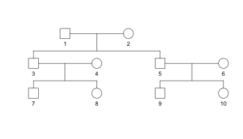

We set the scale matrix to be two times the kinship matrix to model the
direct genetic effect. Each individual also has a standard normally
distributed covariate and a binary covariate. Thus, we can simulate a
data set with a function like:

``` r
# simulates a data set. 
# 
# Args:
#   n_fams: number of families.
#   beta: the fixed effect coefficients.
#   sig_sq: the scale parameter.
sim_dat <- function(n_fams, beta = c(-3, 1, 2), sig_sq = 3){
  # setup before the simulations
  Cmat <- 2 * kinship(ped)
  n_obs <- NROW(fam)
  Sig <- diag(n_obs) + sig_sq * Cmat
  Sig_chol <- chol(Sig)
  
  # simulate the data
  out <- replicate(
    n_fams, {
      # simulate covariates
      X <- cbind(`(Intercept)` = 1, Continuous = rnorm(n_obs), 
                 Binary = runif(n_obs) > .5)
      
      # assign the linear predictor + noise
      eta <- drop(X %*% beta) + drop(rnorm(n_obs) %*% Sig_chol)
      
      # return the list in the format needed for the package
      list(y = as.numeric(eta > 0), X = X, scale_mats = list(Cmat))
    }, simplify = FALSE)
  
  # add attributes with the true values and return 
  attributes(out) <- list(beta = beta, sig_sq = sig_sq)
  out
}
```

The model is

$$
\begin{aligned}
 Y_{ij} &= \begin{cases} 1 & \beta_0 + \beta_1 X_{ij} + \beta_2 B_{ij} + G_{ij} + R_{ij} > 0 \\ 0 & \text{otherwise} \end{cases} \\
 X_{ij} &\sim N(0, 1) \\
 B_{ij} &\sim \text{Bin}(0.5, 1) \\
 (G_{i1}, \dots, G_{in_{i}})^\top &\sim N^{(n_i)}(\vec 0, \sigma^2 C_{i1}) \\
 R_{ij} &\sim N(0, 1)\end{aligned}
$$

where $C_{i1}$ is two times the kinship matrix and $X_{ij}$ and $B_{ij}$
are observed covariates. We can now estimate the model with a simulated
data set as follows:

``` r
# simulate a data set
set.seed(27107390)
dat <- sim_dat(n_fams = 400L)

# perform the optimization. We start with finding the starting values
library(pedmod)
ll_terms <- pedigree_ll_terms(dat, max_threads = 4L)
system.time(start <- pedmod_start(ptr = ll_terms, data = dat, n_threads = 4L))
#>    user  system elapsed 
#>   4.090   0.016   1.074

# log likelihood without the random effects and at the starting values
start$logLik_no_rng
#> [1] -1690
start$logLik_est # this is unreliably/imprecise
#> [1] -1619

# estimate the model
system.time(
  opt_out <- pedmod_opt(
    ptr = ll_terms, par = start$par, abs_eps = 0, use_aprx = TRUE, 
    n_threads = 4L, 
    maxvls = 25000L, rel_eps = 1e-3, minvls = 5000L))
#>    user  system elapsed 
#>  21.240   0.038   5.565
```

The results of the estimation are shown below:

``` r
# parameter estimates versus the truth
rbind(opt_out       = head(opt_out$par, -1), 
      opt_out_quick = head(start  $par, -1), 
      truth         = attr(dat, "beta"))
#>               (Intercept) Continuous Binary
#> opt_out            -2.869     0.9677  1.877
#> opt_out_quick      -2.843     0.9858  1.857
#> truth              -3.000     1.0000  2.000
c(opt_out       = exp(tail(opt_out$par, 1)), 
  opt_out_quick = exp(tail(start  $par, 1)), 
  truth         = attr(dat, "sig_sq"))
#>       opt_out opt_out_quick         truth 
#>         2.897         2.810         3.000

# log marginal likelihoods
print(start   $logLik_est, digits = 8) # this is unreliably/imprecise
#> [1] -1618.5065
print(-opt_out$value     , digits = 8)
#> [1] -1618.4041
```

We emphasize that we set the `rel_eps` parameter to `1e-3` above which
perhaps is fine for this size of a data set but may not be fine for
larger data sets for the following reason. Suppose that we have
$i = 1,\dots,m$ families/clusters and suppose that we estimate the log
likelihood term for each family with a variance of $\zeta$. This implies
that the variance of the log likelihood for all the families is
$\zeta m$. Thus, the precision we require for each family’s log
likelihood term needs to be proportional to $\mathcal O(m^{-1/2})$ if we
want a fixed number of precise digits for the log likelihood for all
number of families. The latter is important e.g.  for the profile
likelihood curve we compute later and also for the line search used by
some optimization methods. Thus, one may need to reduce `rel_eps` and
increase `maxvls` when there are many families.

We can construct standard errors by computing the Hessian using the
`eval_pedigree_hess` function as shown below. Like `eval_pedigree_grad`,
the `eval_pedigree_hess` functions takes in the log of the scale
parameters but the Hessian is computed on the scale of the scale
parameters.

``` r
set.seed(1)
system.time(hess <- eval_pedigree_hess(
  ptr = ll_terms, par = opt_out$par, maxvls = 25000L, minvls = 5000L, abs_eps = 0, 
  rel_eps = 1e-4, do_reorder = TRUE, use_aprx = FALSE, n_threads = 4L))
#>    user  system elapsed 
#>   4.285   0.007   1.090

# the gradient is quite small
sqrt(sum(attr(hess, "grad")^2))
#> [1] 0.1642

# show parameter estimates along with standard errors
rbind(Estimates = opt_out$par, 
      SE = sqrt(diag(attr(hess, "vcov"))))
#>           (Intercept) Continuous Binary       
#> Estimates     -2.8687     0.9677 1.8768 1.0636
#> SE             0.3422     0.1201 0.2358 0.3212
rbind(Estimates = c(head(opt_out$par, -1), exp(tail(opt_out$par, 1))), 
      SE = sqrt(diag(attr(hess, "vcov_org"))))
#>           (Intercept) Continuous Binary       
#> Estimates     -2.8687     0.9677 1.8768 2.8967
#> SE             0.3401     0.1195 0.2346 0.9245
```

We may want to report estimates with the proportion of variances and the
standardized fixed effects coefficients which we show later. This can be
done by applying the delta method. An example is given below.

``` r
# computes the standardized coefficients and proportion of variances. The 
# covariance matrix is computed using the delta method.
# 
# Args:
#   par: the parameter estimates. 
#   n_scales: the number of scale parameters.
#   hess: the output from eval_pedigree_hess
std_prop_estimates <- function(par, n_scales, hess = NULL){
  # transform the parameter estimates
  n_par <- length(par)
  n_fixef <- n_par - n_scales
  idx_scale <- seq_len(n_scales) + n_fixef
  par[idx_scale] <- exp(par[idx_scale])
  total_var <- 1 + sum(par[idx_scale])
  
  denom <- sqrt(total_var)
  d_denom <- -1/(2 * denom * total_var)
  par_out <- c(par[-idx_scale] / denom, par[idx_scale] / total_var)
  
  if(!is.null(hess)){
    # compute the Jacobian from par to par_out
    jac <- matrix(0, n_par, n_par)
    n_fixed <- n_par - n_scales 
    for(i in seq_len(n_fixed)){
      jac[i, i] <- 1 / denom
      jac[i, idx_scale] <- par[i] * d_denom
    }
    
    for(i in seq_len(n_scales)){
      jac[idx_scale[i], idx_scale   ] <- -par[idx_scale[i]] / total_var^2
      jac[idx_scale[i], idx_scale[i]] <- 
        jac[idx_scale[i], idx_scale[i]] + 1 / total_var
    }
    
    # compute the Hessian using the delta method
    vcov_var <- tcrossprod(jac %*% attr(hess, "vcov_org"), jac)
  } else 
    vcov_var <- NULL
  
  list(par = par_out, vcov_var = vcov_var)
}

# show the transformed estimates along with standard errors
std_prop <- std_prop_estimates(opt_out$par, n_scales = 1L, hess = hess)
rbind(
  Truth = std_prop_estimates(
    c(attr(dat, "beta"), log(attr(dat, "sig_sq"))), 1)$par,
  Estimates = std_prop$par, SE = sqrt(diag(std_prop$vcov_var)))
#>           (Intercept) Continuous  Binary        
#> Truth        -1.50000    0.50000 1.00000 0.75000
#> Estimates    -1.45324    0.49021 0.95075 0.74337
#> SE            0.04759    0.02614 0.05043 0.06088
```

### Minimax Tilting

The minimax tilting method suggested by Botev (2017) is also
implemented. The method is more numerically stable when the marginal
likelihood terms are small (for instance with large clusters) or for
certain problems. However, there is some overhead in the implementation
of the method as underflow becomes an issue. This requires more care
which increases the computation time.

We estimate the model below with the minimax tilting using the
`use_tilting` argument.

``` r
# perform the optimization. We start with finding the starting values
set.seed(60941821)
system.time(
  start_tilt <- pedmod_start(
    ptr = ll_terms, data = dat, n_threads = 4L, use_tilting = TRUE, 
    use_aprx = FALSE))
#>    user  system elapsed 
#>  14.637   0.024   3.711

# estimate the model
system.time(
  opt_out_tilt <- pedmod_opt(
    ptr = ll_terms, par = start_tilt$par, abs_eps = 0, use_aprx = FALSE, 
    n_threads = 4L, use_tilting = TRUE,
    maxvls = 25000L, rel_eps = 1e-3, minvls = 5000L))
#>    user  system elapsed 
#>  88.692   0.181  22.603
```

The results of the estimation are shown below:

``` r
# parameter estimates versus the truth
rbind(opt_out_tilt = head(opt_out_tilt$par, -1),
      opt_out      = head(opt_out$par     , -1),
      truth        = attr(dat, "beta"))
#>              (Intercept) Continuous Binary
#> opt_out_tilt      -2.874     0.9694  1.879
#> opt_out           -2.869     0.9677  1.877
#> truth             -3.000     1.0000  2.000
c(opt_out_tilt = exp(tail(opt_out_tilt$par, 1)),
  opt_out      = exp(tail(opt_out$par, 1)), 
  truth        = attr(dat, "sig_sq"))
#> opt_out_tilt      opt_out        truth 
#>        2.912        2.897        3.000

# log marginal likelihoods
print(start        $logLik_est, digits = 8) # this is unreliably/imprecise
#> [1] -1618.5065
print(start_tilt   $logLik_est, digits = 8) # this is unreliably/imprecise
#> [1] -1618.5602

print(-opt_out     $value     , digits = 8)
#> [1] -1618.4041
print(-opt_out_tilt$value     , digits = 8)
#> [1] -1618.4067
```

### Different Optimizer

As the gradient is an approximation, some nonlinear optimizer may give
better results than others. We illustrate this below by using the
`nlminb` function.

``` r
# create a wrapper function
nlminb_wrapper <- function(
  par, fn, gr = NULL, control = list(eval.max = 1000L, iter.max = 1000L), ...){
  out <- nlminb(
    start = par, objective = fn, gradient = gr, control = control, ...)
  within(out, {
    counts <- evaluations
    value <- objective
  })
}

# estimate the model
system.time(
  opt_out_tilt_nlminb <- pedmod_opt(
    ptr = ll_terms, par = start_tilt$par, abs_eps = 0, use_aprx = FALSE, 
    n_threads = 4L, use_tilting = TRUE,
    maxvls = 25000L, rel_eps = 1e-3, minvls = 5000L, opt_func = nlminb_wrapper))
#>    user  system elapsed 
#> 306.631   0.797  78.304
```

The results of the estimation are shown below:

``` r
# parameter estimates versus the truth
rbind(opt_out_tilt_nlminb = head(opt_out_tilt_nlminb$par, -1),
      opt_out_tilt        = head(opt_out_tilt$par, -1),
      opt_out             = head(opt_out$par     , -1),
      truth               = attr(dat, "beta"))
#>                     (Intercept) Continuous Binary
#> opt_out_tilt_nlminb      -2.860     0.9649  1.870
#> opt_out_tilt             -2.874     0.9694  1.879
#> opt_out                  -2.869     0.9677  1.877
#> truth                    -3.000     1.0000  2.000
c(opt_out_tilt_nlminb = exp(tail(opt_out_tilt_nlminb$par, 1)),
  opt_out_tilt        = exp(tail(opt_out_tilt$par, 1)),
  opt_out             = exp(tail(opt_out$par, 1)), 
  truth               = attr(dat, "sig_sq"))
#> opt_out_tilt_nlminb        opt_out_tilt             opt_out               truth 
#>               2.874               2.912               2.897               3.000

# log marginal likelihoods
print(-opt_out            $value, digits = 8)
#> [1] -1618.4041
print(-opt_out_tilt       $value, digits = 8)
#> [1] -1618.4067
print(-opt_out_tilt_nlminb$value, digits = 8)
#> [1] -1618.408
```

### Alternative Parameterization

As an alternative to the direct parameterization we use above, we can
also use the standardized parameterization. Below are some illustrations
which you may skip.

``` r
#####
# transform the parameters and check that we get the same likelihood
std_par <- direct_to_standardized(opt_out$par, n_scales = 1L)
std_par # the standardized parameterization
#> (Intercept)  Continuous      Binary             
#>     -1.4532      0.4902      0.9507      1.0636
opt_out$par # the direct parameterization 
#> (Intercept)  Continuous      Binary             
#>     -2.8687      0.9677      1.8768      1.0636

# we can map back as follows
par_back <- standardized_to_direct(std_par, n_scales = 1L)
all.equal(opt_out$par, par_back, check.attributes = FALSE)
#> [1] TRUE
# the proportion of variance of each effect
attr(par_back, "variance proportions") 
#> Residual          
#>   0.2566   0.7434

# the proportion match
exp(tail(opt_out$par, 1)) / (exp(tail(opt_out$par, 1)) + 1)
#>        
#> 0.7434

# compute the likelihood with either parameterization
set.seed(1L)
eval_pedigree_ll(ptr = ll_terms, par = opt_out$par, maxvls = 10000L, 
                 minvls = 1000L, rel_eps = 1e-3, use_aprx = TRUE, abs_eps = 0)
#> [1] -1618
#> attr(,"n_fails")
#> [1] 10
#> attr(,"std")
#> [1] 0.004044
set.seed(1L)
eval_pedigree_ll(ptr = ll_terms, par = std_par    , maxvls = 10000L, 
                 minvls = 1000L, rel_eps = 1e-3, use_aprx = TRUE, abs_eps = 0, 
                 standardized = TRUE)
#> [1] -1618
#> attr(,"n_fails")
#> [1] 10
#> attr(,"std")
#> [1] 0.004044

# we can also get the same gradient with an application of the chain rule
jac <- attr(
  standardized_to_direct(std_par, n_scales = 1L, jacobian = TRUE), 
  "jacobian")

set.seed(1L)
g1 <- eval_pedigree_grad(ptr = ll_terms, par = opt_out$par, maxvls = 10000L, 
                         minvls = 1000L, rel_eps = 1e-3, use_aprx = TRUE, 
                         abs_eps = 0)
set.seed(1L)
g2 <- eval_pedigree_grad(ptr = ll_terms, par = std_par, maxvls = 10000L, 
                         minvls = 1000L, rel_eps = 1e-3, use_aprx = TRUE, 
                         abs_eps = 0, standardized = TRUE)
all.equal(drop(g1 %*% jac), g2, check.attributes = FALSE)
#> [1] TRUE
```

The model can also be estimated with the standardized parameterization:

``` r
# perform the optimization. We start with finding the starting values
system.time(start_std <- pedmod_start(
  ptr = ll_terms, data = dat, n_threads = 4L, standardized = TRUE))
#>    user  system elapsed 
#>   6.583   0.029   1.718

# the starting values are close
standardized_to_direct(start_std$par, n_scales = 1L)
#> (Intercept)  Continuous      Binary             
#>      -2.844       0.986       1.857       1.034 
#> attr(,"variance proportions")
#> Residual          
#>   0.2623   0.7377
start$par
#> (Intercept)  Continuous      Binary             
#>     -2.8435      0.9858      1.8566      1.0332

# this may have required different number of gradient and function evaluations
start_std$opt$counts
#> function gradient 
#>       26       26
start    $opt$counts
#> function gradient 
#>       48       48

# estimate the model
system.time(
  opt_out_std <- pedmod_opt(
    ptr = ll_terms, par = start_std$par, abs_eps = 0, use_aprx = TRUE, 
    n_threads = 4L, standardized = TRUE,
    maxvls = 25000L, rel_eps = 1e-3, minvls = 5000L))
#>    user  system elapsed 
#>  17.468   0.057   4.589

# we get the same
standardized_to_direct(opt_out_std$par, n_scales = 1L)
#> (Intercept)  Continuous      Binary             
#>     -2.8708      0.9691      1.8771      1.0673 
#> attr(,"variance proportions")
#> Residual          
#>   0.2559   0.7441
opt_out$par
#> (Intercept)  Continuous      Binary             
#>     -2.8687      0.9677      1.8768      1.0636

# this may have required different number of gradient and function evaluations
opt_out_std$counts
#> function gradient 
#>       15       10
opt_out    $counts
#> function gradient 
#>       19       12
```

### Stochastic Quasi-Newton Method

The package includes a stochastic quasi-Newton method which can be used
to estimate the model. This may be useful for larger data sets or in
situations where `pedmod_opt` “get stuck” near a maximum. The reason for
the latter is presumably that `pedmod_opt` (by default) uses the BFGS
method which does not assume any noise in the gradient or the function.
We give an example below of how to use the stochastic quasi-Newton
method provided through the `pedmod_sqn` function.

``` r
# fit the model with the stochastic quasi-Newton method
set.seed(46712994)
system.time(
  sqn_out <- pedmod_sqn(
    ptr = ll_terms, par = start$par, abs_eps = 0, use_aprx = TRUE, 
    n_threads = 4L, rel_eps = 1e-3, step_factor = .1, maxvls = 25000L, 
    minvls = 1000L, n_it = 400L, n_grad_steps = 10L, n_grad = 100L, 
    n_hess = 400L))
#>    user  system elapsed 
#> 188.660   0.607  50.666

# show the log marginal likelihood
ll_wrapper <- function(x)
  eval_pedigree_ll(
    ptr = ll_terms, x, maxvls = 50000L, minvls = 1000L, abs_eps = 0, 
    rel_eps = 1e-4, n_threads = 4L)
print(ll_wrapper(sqn_out$par), digits = 8)
#> [1] -1618.4386
#> attr(,"n_fails")
#> [1] 151
#> attr(,"std")
#> [1] 0.00073285073
print(ll_wrapper(opt_out$par), digits = 8)
#> [1] -1618.4076
#> attr(,"n_fails")
#> [1] 158
#> attr(,"std")
#> [1] 0.00074727461

# compare the parameters
rbind(optim = opt_out$par, 
      sqn   = sqn_out$par)
#>       (Intercept) Continuous Binary      
#> optim      -2.869     0.9677  1.877 1.064
#> sqn        -2.838     0.9689  1.861 1.038

# plot the marginal log likelihood versus the iteration number
lls <- apply(sqn_out$omegas, 2L, ll_wrapper)
par(mar = c(5, 5, 1, 1))
plot(lls, ylab = "Log marginal likelihood", bty = "l", pch = 16,
     xlab = "Hessian updates")
lines(smooth.spline(seq_along(lls), lls))
grid()
```

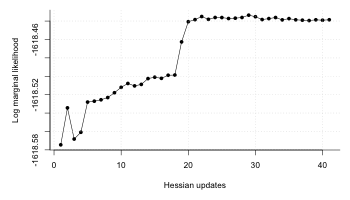

``` r
# perhaps we could have used fewer samples in each iteration
set.seed(46712994)
system.time(
  sqn_out_few <- pedmod_sqn(
    ptr = ll_terms, par = start$par, abs_eps = 0, use_aprx = TRUE, 
    n_threads = 4L, rel_eps = 1e-3, step_factor = .1, maxvls = 25000L, 
    minvls = 1000L, n_grad_steps = 20L,
    # we take more iterations
    n_it = 2000L, 
    # but use fewer samples in each iteration
    n_grad = 20L, n_hess = 100L))
#>    user  system elapsed 
#>  184.57    0.69   49.96

# compute the marginal log likelihood and compare the parameter estimates
print(ll_wrapper(sqn_out_few$par), digits = 8)
#> [1] -1618.4382
#> attr(,"n_fails")
#> [1] 157
#> attr(,"std")
#> [1] 0.00072082738

rbind(optim       = opt_out    $par, 
      sqn         = sqn_out    $par, 
      `sqn (few)` = sqn_out_few$par)
#>           (Intercept) Continuous Binary      
#> optim          -2.869     0.9677  1.877 1.064
#> sqn            -2.838     0.9689  1.861 1.038
#> sqn (few)      -2.831     0.9548  1.864 1.036
```

### Profile Likelihood Curve

We can compute a profile likelihood curve like this:

``` r
# assign the scale parameter at which we will evaluate the profile likelihood
rg <- range(exp(tail(opt_out$par, 1) / 2) * c(.5, 2),
            sqrt(attr(dat, "sig_sq")) * c(.9, 1.1))
sigs <- seq(rg[1], rg[2], length.out = 10)
sigs <- sort(c(sigs, exp(tail(opt_out$par, 1) / 2)))

# compute the profile likelihood
ll_terms <- pedigree_ll_terms(dat, max_threads = 4L)
pl_curve_res <- lapply(sigs, function(sig){
  # set the parameters to pass
  beta <- start$beta_no_rng
  sig_sq_log <- 2 * log(sig)
  beta_scaled <- beta * sqrt(1 + sig^2)
  
  # optimize like before but using the fix argument
  opt_out_quick <- pedmod_opt(
    ptr = ll_terms, par = c(beta_scaled, sig_sq_log), maxvls = 1000L, 
    abs_eps = 0, rel_eps = 1e-2, minvls = 100L, use_aprx = TRUE, n_threads = 4L, 
    fix = length(beta) + 1L)
  opt_out <- pedmod_opt(
    ptr = ll_terms, par = c(opt_out_quick$par, sig_sq_log), abs_eps = 0, 
    use_aprx = TRUE, n_threads = 4L, fix = length(beta) + 1L,
    # we changed these parameters
    maxvls = 25000L, rel_eps = 1e-3, minvls = 5000L)
  
  # report to console and return
  message(sprintf("\nLog likelihood %.5f (%.5f). Estimated parameters:", 
                  -opt_out$value, -opt_out_quick$value))
  message(paste0(capture.output(print(
    c(opt_out$par, Scale = sig))), collapse = "\n"))
  
  list(opt_out_quick = opt_out_quick, opt_out = opt_out)
})
```

We can construct an approximate 95% confidence interval using an
estimated cubic smoothing spline for the profile likelihood (more `sigs`
points may be needed to get a good estimate of the smoothing spline):

``` r
# get the critical values
alpha <- .05
crit_val <- qchisq(1 - alpha, 1)

# fit the cubic smoothing spline
pls <- -sapply(pl_curve_res, function(x) x$opt_out$value)
smooth_est <- smooth.spline(sigs, pls)

# check that we have values within the bounds
max_ml <- -opt_out$value
ll_diffs <- 2 * (max_ml - pls)
stopifnot(any(head(ll_diffs, length(ll_diffs) / 2) > crit_val), 
          any(tail(ll_diffs, length(ll_diffs) / 2) > crit_val))

# find the values
max_par <- tail(opt_out$par, 1)
lb <- uniroot(function(x) 2 * (max_ml - predict(smooth_est, x)$y) - crit_val, 
              c(min(sigs)       , exp(max_par / 2)))$root
ub <- uniroot(function(x) 2 * (max_ml - predict(smooth_est, x)$y) - crit_val, 
              c(exp(max_par / 2), max(sigs)))$root

# the confidence interval 
c(lb, ub)
#> [1] 1.259 2.528
c(lb, ub)^2 # on the variance scale
#> [1] 1.586 6.391
```

A caveat is that issues with the $\chi^2$ approximation may arise on the
boundary of the scale parameter ($\sigma = 0$; e.g.  see
<https://stats.stackexchange.com/a/4894/81865>). Notice that the above
may fail if the estimated profile likelihood is not smooth e.g. because
of convergence issues. We can plot the profile likelihood and highlight
the critical value as follows:

``` r
par(mar = c(5, 5, 1, 1))
plot(sigs, pls, bty = "l",
     pch = 16, xlab = expression(sigma), ylab = "Profile likelihood")
grid()
lines(predict(smooth_est, seq(min(sigs), max(sigs), length.out = 100)))
abline(v = exp(tail(opt_out$par, 1) / 2), lty = 2) # the estimate
abline(v = sqrt(attr(dat, "sig_sq")), lty = 3) # the true value
abline(v = lb, lty = 3) # mark the lower bound
abline(v = ub, lty = 3) # mark the upper bound
abline(h = max_ml - crit_val / 2, lty = 3) # mark the critical value
```

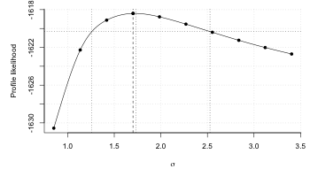

The `pedmod_profile` function is a convenience function to do like
above. An example of using the `pedmod_profile` function is provided
below:

``` r
# find the profile likelihood based confidence interval
prof_res <- pedmod_profile(
  ptr = ll_terms, par = opt_out$par, delta = .5, maxvls = 10000L, 
  minvls = 1000L, alpha = .05, abs_eps = 0, rel_eps = 1e-4, which_prof = 4L,
  use_aprx = TRUE, n_threads = 4L, verbose = TRUE)
#> The estimate of the standard error of the log likelihood is 0.00264430. Preferably this should be below 0.001
#> 
#> Finding the lower limit of the profile likelihood curve
#> LogLike: -1619.7835 at         0.563571
#> LogLike: -1619.7818 at         0.563571
#> LogLike: -1624.4883 at         0.063571
#> LogLike: -1624.4826 at         0.063571
#> LogLike: -1620.8682 at         0.407134. Lb, target, ub: -1620.8682, -1620.3321, -1619.7818
#> LogLike: -1620.8633 at         0.407134. Lb, target, ub: -1620.8633, -1620.3321, -1619.7818
#> LogLike: -1620.3414 at         0.476826. Lb, target, ub: -1620.3414, -1620.3321, -1619.7818
#> LogLike: -1620.3391 at         0.476826. Lb, target, ub: -1620.3391, -1620.3321, -1619.7818
#> 
#> Finding the upper limit of the profile likelihood curve
#> LogLike: -1619.3056 at         1.563571
#> LogLike: -1619.2923 at         1.563571
#> LogLike: -1621.1906 at         2.063571
#> LogLike: -1621.1630 at         2.063571
#> LogLike: -1620.2887 at         1.837915. Lb, target, ub: -1621.1630, -1620.3321, -1620.2887
#> LogLike: -1620.2667 at         1.837915. Lb, target, ub: -1621.1630, -1620.3321, -1620.2667
#> LogLike: -1620.4487 at         1.878347. Lb, target, ub: -1620.4487, -1620.3321, -1620.2667
#> LogLike: -1620.4225 at         1.878347. Lb, target, ub: -1620.4225, -1620.3321, -1620.2667
#> LogLike: -1618.4113 at         1.063571

# the confidence interval for the scale parameter
exp(prof_res$confs)
#>  2.50 pct. 97.50 pct. 
#>      1.613      6.391

# compare with Wald based confidence intervals on the log scale
Wald_conf <- tail(opt_out$par, 1) + c(-1, 1) * qnorm(.975) *
  sqrt(tail(diag(attr(hess, "vcov")), 1))
rbind(Wald = Wald_conf, `Profile likelihood` = prof_res$confs)
#>                    2.50 pct. 97.50 pct.
#> Wald                  0.4340      1.693
#> Profile likelihood    0.4778      1.855

# plot the estimated profile likelihood curve and check that everything looks 
# fine
sigs <- exp(prof_res$xs / 2)
pls <- prof_res$p_log_Lik
par(mar = c(5, 5, 1, 1))
plot(log(sigs), pls, bty = "l",
     pch = 16, xlab = expression(log(sigma)), ylab = "Profile likelihood")
grid()
smooth_est <- smooth.spline(log(sigs), pls)
lines(predict(smooth_est, log(seq(min(sigs), max(sigs), length.out = 100))))
abline(v = exp(tail(opt_out$par, 1) / 2), lty = 2) # the estimate
abline(v = sqrt(attr(dat, "sig_sq")), lty = 3) # the true value
abline(h = max(pls) - qchisq(.95, 1) / 2, lty = 3) # mark the critical value

abline(v = Wald_conf / 2, lty = 4) # Wald
abline(v = prof_res$confs / 2, lty = 3) # Profile likelihood
```

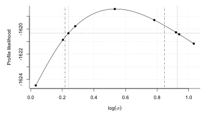

``` r

# we can do the same for the slope of the binary covariates
prof_res <- pedmod_profile(
  ptr = ll_terms, par = opt_out$par, delta = .5, maxvls = 10000L, 
  minvls = 1000L, alpha = .05, abs_eps = 0, rel_eps = 1e-4, which_prof = 3L,
  use_aprx = TRUE, n_threads = 4L, verbose = TRUE)
#> The estimate of the standard error of the log likelihood is 0.00264430. Preferably this should be below 0.001
#> 
#> Finding the lower limit of the profile likelihood curve
#> LogLike: -1622.3968 at         1.376782
#> LogLike: -1622.3898 at         1.376782
#> LogLike: -1618.4113 at         1.876782
#> LogLike: -1619.2913 at         1.606657. Lb, target, ub: -1622.3898, -1620.3321, -1619.2913
#> LogLike: -1619.2872 at         1.606657. Lb, target, ub: -1622.3898, -1620.3321, -1619.2872
#> LogLike: -1620.4825 at         1.490192. Lb, target, ub: -1620.4825, -1620.3321, -1619.2872
#> LogLike: -1620.4797 at         1.490192. Lb, target, ub: -1620.4797, -1620.3321, -1619.2872
#> LogLike: -1620.1983 at         1.512500. Lb, target, ub: -1620.4797, -1620.3321, -1620.1983
#> LogLike: -1620.1979 at         1.512500. Lb, target, ub: -1620.4797, -1620.3321, -1620.1979
#> 
#> Finding the upper limit of the profile likelihood curve
#> LogLike: -1619.6122 at         2.376782
#> LogLike: -1619.5924 at         2.376782
#> LogLike: -1621.3738 at         2.876782
#> LogLike: -1621.3456 at         2.876782
#> LogLike: -1620.5417 at         2.635011. Lb, target, ub: -1620.5417, -1620.3321, -1619.5924
#> LogLike: -1620.5179 at         2.635011. Lb, target, ub: -1620.5179, -1620.3321, -1619.5924
#> LogLike: -1620.2805 at         2.561459. Lb, target, ub: -1620.5179, -1620.3321, -1620.2805
#> LogLike: -1620.2564 at         2.561459. Lb, target, ub: -1620.5179, -1620.3321, -1620.2564
#> LogLike: -1618.4113 at         1.876782

# the confidence interval for the slope of the binary covariate
prof_res$confs
#>  2.50 pct. 97.50 pct. 
#>      1.502      2.583

# compare w/ Wald
Wald_conf <- opt_out$par[3] + c(-1, 1) * qnorm(.975) *
  sqrt(diag(attr(hess, "vcov"))[3])
rbind(Wald = Wald_conf, `Profile likelihood` = prof_res$confs)
#>                    2.50 pct. 97.50 pct.
#> Wald                   1.415      2.339
#> Profile likelihood     1.502      2.583
```

``` r
# plot the estimated profile likelihood curve and check that everything looks 
# fine
bin_slope <- prof_res$xs
pls <- prof_res$p_log_Lik
par(mar = c(5, 5, 1, 1))
plot(bin_slope, pls, bty = "l",
     pch = 16, xlab = expression(beta[2]), ylab = "Profile likelihood")
grid()
lines(spline(bin_slope, pls, n = 100))
abline(v = opt_out$par[3], lty = 2) # the estimate
abline(v = attr(dat, "beta")[3], lty = 3) # the true value
abline(h = max(pls) - qchisq(.95, 1) / 2, lty = 3) # mark the critical value
```

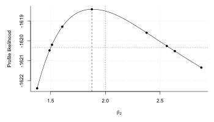

We only ran the above with one seed. We can draw the curve with using
different seeds to check if this does not change the estimates. We will
likely need to use more samples if the result depends on the seed.

``` r
# compute the profile likelihood using different seeds
pl_curve_res <- lapply(1:5, function(seed) pedmod_profile(
  ptr = ll_terms, par = opt_out$par, delta = .5, maxvls = 10000L, 
  minvls = 1000L, alpha = .05, abs_eps = 0, rel_eps = 1e-4, which_prof = 4L,
  use_aprx = TRUE, n_threads = 4L, seed = seed))
```

We show the estimated profile likelihood based confidence intervals
below:

``` r
# the profile likelihood based confidence intervals
print(exp(t(sapply(pl_curve_res, `[[`, "confs"))), digits = 8)
#>      2.50 pct. 97.50 pct.
#> [1,] 1.6125811  6.3912642
#> [2,] 1.6111064  6.4104380
#> [3,] 1.6124439  6.3921782
#> [4,] 1.6119465  6.3900540
#> [5,] 1.6121094  6.4145901
```

### Randomized Quasi-Monte Carlo

There are two randomized quasi-Monte Carlo methods which are implemented
in the package: randomized Korobov rules as in the implementation by
Genz and Bretz (2002) and scrambled Sobol sequences. The former is used
by default. The questions is which method to use. As an example, we will
increase the number of samples with either methods and see how this
effects the error for the gradient of the log likelihood from the first
couple of families. We do this below:

``` r
# create a simple function which computes the gradient. We set the convergence 
# threshold values low such that all the samples will be used
gr <- function(maxvls, method, par = start$par, minvls = 500L)
  eval_pedigree_grad(ptr = ll_terms, par = par, maxvls = maxvls, abs_eps = 0,
                     rel_eps = 1e-12, indices = 0:9, minvls = minvls, 
                     method = method, n_threads = 4L)

# compute the estimator for either method using an increasing number of samples
n_samp <- 1000 * 2^(0:9) # the sample sizes we will use
seeds <- 1:40 # the seeds we will use

res <- sapply(setNames(n_samp, n_samp), function(maxvls){
  sapply(c(Korobov = 0, Sobol = 1), function(method){
    # estimate the gradient
    ests <- sapply(seeds, function(s){
      set.seed(s)
      gr(maxvls = maxvls, minvls = maxvls, method = method)
    })
    
    # return the mean of the estimators and the standard deviation
    rbind(mean = rowMeans(ests), 
          sd = apply(ests, 1L, sd))
  }, simplify = "array")
}, simplify = "array")

# set the names of the dimensions
dimnames(res) <- list(
  metric = dimnames(res)[[1L]], parameter = names(opt_out$par),
  method = dimnames(res)[[3L]], samples = n_samp)

# they seem to converge to the same estimate as expected
print(t(res["mean", , "Korobov", ]), digits = 6)
#>         parameter
#> samples  (Intercept) Continuous   Binary          
#>   1000     -0.543256    3.07298 -1.64784 -0.903480
#>   2000     -0.545435    3.07202 -1.64914 -0.904215
#>   4000     -0.545674    3.07133 -1.64886 -0.903661
#>   8000     -0.545885    3.07252 -1.64968 -0.902066
#>   16000    -0.545608    3.07225 -1.64953 -0.903363
#>   32000    -0.545631    3.07220 -1.64942 -0.903131
#>   64000    -0.545617    3.07231 -1.64947 -0.902905
#>   128000   -0.545648    3.07229 -1.64947 -0.902894
#>   256000   -0.545645    3.07225 -1.64948 -0.902954
#>   512000   -0.545649    3.07226 -1.64949 -0.902931
print(t(res["mean", , "Sobol"  , ]), digits = 6)
#>         parameter
#> samples  (Intercept) Continuous   Binary          
#>   1000     -0.545721    3.07321 -1.64964 -0.909602
#>   2000     -0.544991    3.07324 -1.64897 -0.907947
#>   4000     -0.546137    3.07254 -1.64926 -0.903329
#>   8000     -0.545476    3.07168 -1.64941 -0.903138
#>   16000    -0.545692    3.07229 -1.64919 -0.902540
#>   32000    -0.545640    3.07232 -1.64940 -0.902620
#>   64000    -0.545649    3.07220 -1.64946 -0.902905
#>   128000   -0.545641    3.07222 -1.64945 -0.902899
#>   256000   -0.545652    3.07226 -1.64946 -0.902871
#>   512000   -0.545651    3.07226 -1.64948 -0.902917

# get a best estimator of the gradient by combining the two
precise_est <- rowMeans(res["mean", , , length(n_samp)])
  
# the standard deviation of the result scaled by the absolute value of the 
# estimated gradient to get the number of significant digits
round(t(res["sd", , "Korobov", ] / abs(precise_est)), 6)
#>         parameter
#> samples  (Intercept) Continuous   Binary         
#>   1000      0.020405   0.008022 0.006442 0.026858
#>   2000      0.003957   0.001780 0.001473 0.007803
#>   4000      0.004618   0.002069 0.001823 0.008827
#>   8000      0.001635   0.000607 0.000610 0.003487
#>   16000     0.000653   0.000251 0.000256 0.001579
#>   32000     0.000389   0.000155 0.000168 0.001423
#>   64000     0.000235   0.000103 0.000094 0.000637
#>   128000    0.000075   0.000028 0.000025 0.000217
#>   256000    0.000046   0.000022 0.000024 0.000162
#>   512000    0.000091   0.000041 0.000033 0.000286
round(t(res["sd", , "Sobol"  , ] / abs(precise_est)), 6)
#>         parameter
#> samples  (Intercept) Continuous   Binary         
#>   1000      0.019466   0.008727 0.007274 0.033460
#>   2000      0.011398   0.004238 0.004861 0.020079
#>   4000      0.006187   0.002074 0.002653 0.013703
#>   8000      0.003145   0.001051 0.001301 0.005196
#>   16000     0.001674   0.000675 0.000741 0.003350
#>   32000     0.000833   0.000346 0.000284 0.001169
#>   64000     0.000352   0.000175 0.000173 0.000862
#>   128000    0.000193   0.000083 0.000076 0.000398
#>   256000    0.000099   0.000051 0.000049 0.000203
#>   512000    0.000047   0.000020 0.000017 0.000132
```

``` r
# look at a log-log regression to check convergence rate. We expect a rate 
# between 0.5, O(sqrt(n)) rate, and 1, O(n) rate, which can be seen from minus  
# the slopes below
coef(lm(t(log(res["sd", , "Korobov", ])) ~ log(n_samp)))
#>             (Intercept) Continuous  Binary        
#> (Intercept)       1.405     2.1637  1.2910  1.4868
#> log(n_samp)      -0.934    -0.9249 -0.9073 -0.8022
coef(lm(t(log(res["sd", , "Sobol", ])) ~ log(n_samp)))
#>             (Intercept) Continuous Binary        
#> (Intercept)      2.3745     2.8576  2.551  3.0370
#> log(n_samp)     -0.9797    -0.9438 -0.975 -0.9277

# plot the two standard deviation estimates
par(mar = c(5, 5, 1, 1))
matplot(n_samp, t(res["sd", , "Korobov", ]), log = "xy", ylab = "L2 error", 
        type = "p", pch = c(0:2, 5L), col = "black", bty = "l", 
        xlab = "Number of samples", ylim = range(res["sd", , , ]))
matlines(n_samp, t(res["sd", , "Korobov", ]), col = "black", lty = 2)

# add the points from Sobol method
matplot(n_samp, t(res["sd", , "Sobol", ]), type = "p", pch = 15:18, 
        col = "darkgray", add = TRUE)
matlines(n_samp, t(res["sd", , "Sobol", ]), col = "darkgray", lty = 3)
```

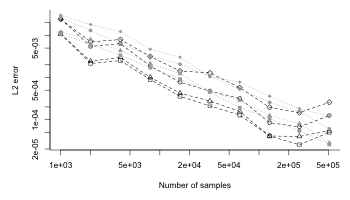

The above seems to suggest that the randomized Korobov rules are
preferable and that both method achieve close to a
$O(n^{-1 + \epsilon})$ rate for some small $\epsilon$. Notice that we
have to set `minvls` equal to `maxvls` to achieve the
$O(n^{-1 + \epsilon})$ rate with randomized Korobov rules.

We can also consider the convergence rate for the log likelihood. This
time, we also consider the error using the minimax tilted version
suggested by Botev (2017). We also show how the error can be reduced by
using fewer randomized qausi-Monte Carlo sequences at the cost of the
precision of the error estimate:

``` r
# create a simple function which computes the log likelihood. We set the 
# convergence threshold values low such that all the samples will be used
fn <- function(maxvls, method, par = start$par, ptr = ll_terms,  minvls = 500L, 
               use_tilting)
  eval_pedigree_ll(ptr = ptr, par = par, maxvls = maxvls, abs_eps = 0,
                   rel_eps = 1e-12, indices = 0:9, minvls = minvls, 
                   method = method, n_threads = 4L, use_tilting = use_tilting)

# compute the estimator for either method using an increasing number of samples
res <- sapply(setNames(n_samp, n_samp), function(maxvls){
  sapply(c(`W/ tilting` = TRUE, `W/o tilting` = FALSE), function(use_tilting){
    sapply(c(Korobov = 0, Sobol = 1), function(method){
      # estimate the gradient
      ests <- sapply(seeds, function(s){
        set.seed(s)
        fn(maxvls = maxvls, minvls = maxvls, method = method, 
           use_tilting = use_tilting)
      })
      
      # return the mean of the estimators and the standard deviation
      c(mean = mean(ests), sd = sd(ests))
    }, simplify = "array")
  }, simplify  = "array")
}, simplify = "array")

# compute the errors with fewer randomized quasi-Monte Carlo sequences
ll_terms_few_sequences <- pedigree_ll_terms(dat, max_threads = 4L, 
                                            n_sequences = 1L)
res_few_seqs <- sapply(setNames(n_samp, n_samp), function(maxvls){
  sapply(c(`W/ tilting` = TRUE, `W/o tilting` = FALSE), function(use_tilting){
    sapply(c(Korobov = 0, Sobol = 1), function(method){
      # estimate the gradient
      ests <- sapply(seeds, function(s){
        set.seed(s)
        fn(maxvls = maxvls, minvls = maxvls, method = method, 
           ptr = ll_terms_few_sequences, use_tilting = use_tilting)
      })
      
      # return the mean of the estimators and the standard deviation
      c(mean = mean(ests), sd = sd(ests))
    }, simplify = "array")
  }, simplify = "array")
}, simplify = "array")
```

``` r
# the standard deviation of the result scaled by the absolute value of the 
# estimated log likelihood to get the number of significant digits. Notice that
# we scale up the figures by 1000!
precise_est <- mean(res["mean", , , length(n_samp)])
round(1000 * res["sd", "Korobov", , ] / abs(precise_est), 6)
#>                1000     2000    4000     8000    16000    32000    64000
#> W/ tilting  0.05251 0.008956 0.01149 0.004567 0.001832 0.001027 0.000574
#> W/o tilting 0.06356 0.011442 0.01383 0.004871 0.002328 0.000949 0.000855
#>               128000   256000   512000
#> W/ tilting  0.000190 0.000102 0.000123
#> W/o tilting 0.000219 0.000160 0.000245
round(1000 * res["sd", "Sobol"  , , ] / abs(precise_est), 6)
#>                1000    2000    4000     8000    16000    32000   64000   128000
#> W/ tilting  0.03415 0.02132 0.01507 0.006703 0.003522 0.002073 0.00108 0.000479
#> W/o tilting 0.10914 0.04649 0.02481 0.011070 0.006089 0.003202 0.00126 0.000630
#>               256000   512000
#> W/ tilting  0.000238 0.000101
#> W/o tilting 0.000336 0.000170

# with fewer sequences
round(1000 * res_few_seqs["sd", "Korobov", , ] / abs(precise_est), 6)
#>                1000     2000     4000     8000    16000    32000    64000
#> W/ tilting  0.01134 0.005191 0.002951 0.001581 0.000506 0.000354 0.000412
#> W/o tilting 0.01389 0.004952 0.003054 0.002180 0.000653 0.000439 0.000625
#>               128000  256000  512000
#> W/ tilting  0.000223 4.8e-05 5.1e-05
#> W/o tilting 0.000190 5.1e-05 5.3e-05
round(1000 * res_few_seqs["sd", "Sobol"  , , ] / abs(precise_est), 6)
#>                1000     2000    4000     8000    16000    32000    64000
#> W/ tilting  0.01700 0.008481 0.00532 0.002886 0.001269 0.000766 0.000323
#> W/o tilting 0.03369 0.016385 0.00741 0.004601 0.001951 0.000920 0.000505
#>               128000   256000  512000
#> W/ tilting  0.000130 0.000066 3.0e-05
#> W/o tilting 0.000208 0.000109 6.3e-05

# look at log-log regressions
apply(res["sd", , , ], 1:2, function(sds) coef(lm(log(sds) ~ log(n_samp))))
#> , , W/ tilting
#> 
#>             Korobov   Sobol
#> (Intercept)  0.1602  0.1000
#> log(n_samp) -0.9890 -0.9366
#> 
#> , , W/o tilting
#> 
#>             Korobov  Sobol
#> (Intercept) -0.1444  1.593
#> log(n_samp) -0.9335 -1.033

# plot the standard deviation estimates. Dashed lines are with fewer sequences
par(mar = c(5, 5, 1, 1))
create_plot <- function(results, ylim){
  sds <- matrix(results["sd", , , ], ncol = dim(results)[4])
  dimnames(sds) <- 
    list(do.call(outer, c(dimnames(results)[2:3], list(FUN = paste))), NULL)
  
  lty <- c(1, 1, 2, 2)
  col <- rep(c("black", "darkgray"), 2)
  matplot(n_samp, t(sds), log = "xy", ylab = "L2 error", lty = lty, 
        type = "l", bty = "l", xlab = "Number of samples", 
        col = col, ylim = ylim)
  matplot(n_samp, t(sds), pch = c(1, 16), col = col, 
          add = TRUE)
  legend("bottomleft", bty = "n", lty = lty, col = col, 
         legend = rownames(sds))
  grid()
}

# with more sequences
ylim_plot <- range(res["sd", , , ], res_few_seqs["sd", , , ])
create_plot(res, ylim = ylim_plot)
```

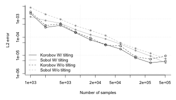

``` r
# with one sequence
create_plot(res_few_seqs, ylim = ylim_plot)
```

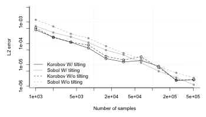

Again the randomized Korobov rules seems preferable. In general, a
strategy can be to use only one randomized quasi-Monte Carlo sequence as
above and set `minvls` and `maxvls` to the desired number of samples.
This will though imply that the method cannot stop early if it is easy
to approximate the log likelihood and its derivative. We fit the model
again below as example of using the scrambled Sobol sequences:

``` r
# estimate the model using Sobol sequences
system.time(
  opt_out_sobol <- pedmod_opt(
    ptr = ll_terms, par = start$par, abs_eps = 0, use_aprx = TRUE, 
    n_threads = 4L, 
    maxvls = 25000L, rel_eps = 1e-3, minvls = 5000L, method = 1L))
#>    user  system elapsed 
#>  28.938   0.085   7.647

# compare the result. We start with the log likelihood
print(-opt_out_sobol$value, digits = 8)
#> [1] -1618.4027
print(-opt_out      $value, digits = 8)
#> [1] -1618.4041

# the parameters
rbind(Korobov = opt_out      $par, 
      Sobol   = opt_out_sobol$par)
#>         (Intercept) Continuous Binary      
#> Korobov      -2.869     0.9677  1.877 1.064
#> Sobol        -2.874     0.9692  1.880 1.068

# number of used function and gradient evaluations
opt_out$counts
#> function gradient 
#>       19       12
opt_out_sobol$counts
#> function gradient 
#>       12       10
```

### Simulation Study

We make a small simulation study below where we are interested in the
estimation time, bias and coverage of Wald type confidence intervals.

``` r
# the seeds we will use
seeds <- c(36451989L, 18774630L, 76585289L, 31898455L, 55733878L, 99681114L, 37725150L, 99188448L, 66989159L, 20673587L, 47985954L, 42571905L, 53089211L, 18457743L, 96049437L, 70222325L, 86393368L, 45380572L, 81116968L, 48291155L, 89755299L, 69891073L, 1846862L, 15263013L, 37537710L, 
           25194071L, 14471551L, 38278606L, 55596031L, 5436537L, 75008107L, 83382936L, 50689482L, 71708788L, 52258337L, 23423931L, 61069524L, 24452554L, 32406673L, 14900280L, 24818537L, 59733700L, 82407492L, 95500692L, 62528680L, 88728797L, 9891891L, 36354594L, 69630736L, 41755287L)

# run the simulation study
sim_study <- lapply(seeds, function(s){
  set.seed(s)
  
  # only run the result if it has not been computed
  f <- file.path("cache", "sim_study_simple", paste0("simple-", s, ".RDS"))
  if(!file.exists(f)){
    # simulate the data
    dat <- sim_dat(n_fams = 400L)
    
    # get the starting values
    library(pedmod)
    do_fit <- function(standardized){
      ll_terms <- pedigree_ll_terms(dat, max_threads = 4L)
      ti_start <- system.time(start <- pedmod_start(
        ptr = ll_terms, data = dat, n_threads = 4L, 
        standardized = standardized))
      start$time <- ti_start
      
      ti_fit <- system.time(
        opt_out <- pedmod_opt(
          ptr = ll_terms, par = start$par, abs_eps = 0, use_aprx = TRUE, 
          n_threads = 4L, 
          maxvls = 25000L, rel_eps = 1e-3, minvls = 5000L, 
          standardized = standardized))
      opt_out$time <- ti_fit
      
      if(standardized){
        start$par   <- standardized_to_direct(start$par, 1L)
        opt_out$par <- standardized_to_direct(opt_out$par, 1L)
      }
      
      if(!standardized){
        hess_time <- system.time(
          hess <- eval_pedigree_hess(
            ptr = ll_terms, par = opt_out$par, maxvls = 25000L, 
            abs_eps = 0, minvls = 5000L, use_aprx = TRUE, 
            rel_eps = 1e-4, n_threads = 4L))
        attr(hess, "time") <- hess_time
      } else
        hess <- NULL
      
      list(start = start, opt_out = opt_out, hess = hess,
           ll_no_rng = start$logLik_no_rng)
    }
    
    fit_direct <- do_fit(standardized = FALSE)
    fit_std    <- do_fit(standardized = TRUE)
    saveRDS(list(fit_direct = fit_direct, fit_std = fit_std), f)
  }
  
  # report to console and return 
  out <- readRDS(f)
  message(paste0(capture.output(out$fit_direct$opt_out$par), collapse = "\n"))
  message(paste0(capture.output(out$fit_std   $opt_out$par), collapse = "\n"))
  
  par <- out$fit_direct$opt_out$par
  SEs <- sqrt(diag(attr(out$fit_direct$hess, "vcov")))
  
  message(paste0(capture.output(rbind(
    Estimate = par, SE = SEs)), collapse = "\n"))
  message(sprintf(
    "Time %12.1f, %12.1f. Max ll: %12.4f, %12.4f\n",
    with(out$fit_direct, start$time["elapsed"] + opt_out$time["elapsed"]),
    with(out$fit_std   , start$time["elapsed"] + opt_out$time["elapsed"]),
    -out$fit_direct$opt_out$value,
    -out$fit_std   $opt_out$value))
  
  out
})

# gather the estimates
beta_est <- sapply(sim_study, function(x) 
  cbind(Direct       = head(x$fit_direct$opt_out$par, 3), 
        Standardized = head(x$fit_std   $opt_out$par, 3)), 
  simplify = "array")
sigma_est <- sapply(sim_study, function(x) 
  cbind(Direct       = exp(tail(x$fit_direct$opt_out$par, 1) / 2), 
        Standardized = exp(tail(x$fit_std   $opt_out$par, 1) / 2)), 
  simplify = "array")

# compute the errors
tmp <- sim_dat(2L)
err_beta  <- beta_est  - attr(tmp, "beta")
err_sigma <- sigma_est - sqrt(attr(tmp, "sig_sq"))
dimnames(err_sigma)[[1L]] <- "std genetic"
err <- abind::abind(err_beta, err_sigma, along = 1)

# get the bias estimates and the standard errors
bias <- apply(err, 1:2, mean)
n_sims <- dim(err)[[3]]
SE <- apply(err , 1:2, sd) / sqrt(n_sims)
bias
#>               Direct Standardized
#> (Intercept) -0.06615     -0.06589
#> Continuous   0.02828      0.02821
#> Binary       0.03764      0.03741
#> std genetic  0.05655      0.05648
SE
#>              Direct Standardized
#> (Intercept) 0.05079      0.05041
#> Continuous  0.01717      0.01707
#> Binary      0.03369      0.03343
#> std genetic 0.03905      0.03878

# make a box plot
b_vals <- expand.grid(rownames(err), strtrim(colnames(err), 1))
box_dat <- data.frame(Error = c(err), 
                      Parameter = rep(b_vals$Var1, n_sims), 
                      Method = rep(b_vals$Var2, dim(err)[[3]]))
par(mar = c(7, 5, 1, 1))
# S is for the standardized and D is for the direct parameterization
boxplot(Error ~ Method + Parameter, box_dat, ylab = "Error", las = 2, 
        xlab = "")
abline(h = 0, lty = 2)
grid()
```

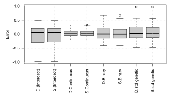

``` r
# get the average computation times
time_vals <- sapply(sim_study, function(x) {
  . <- function(z){
    keep <- c("opt_out", "start")
    out <- setNames(sapply(z[keep], function(z) z$time["elapsed"]), keep)
    c(out, total = sum(out))
  }
  
  rbind(Direct       = .(x$fit_direct), 
        Standardized = .(x$fit_std))
}, simplify = "array")
apply(time_vals, 1:2, mean)
#>              opt_out  start total
#> Direct         3.510 1.0033 4.513
#> Standardized   4.555 0.8669 5.422
apply(time_vals, 1:2, sd)
#>              opt_out  start total
#> Direct         1.953 0.6532 2.138
#> Standardized   1.394 0.5358 1.411
apply(time_vals, 1:2, quantile)
#> , , opt_out
#> 
#>      Direct Standardized
#> 0%    1.528        2.347
#> 25%   2.312        3.392
#> 50%   2.612        4.675
#> 75%   4.659        5.553
#> 100% 11.965        7.179
#> 
#> , , start
#> 
#>      Direct Standardized
#> 0%   0.3920       0.3780
#> 25%  0.6075       0.6082
#> 50%  0.6985       0.6750
#> 75%  1.2015       0.9495
#> 100% 3.1350       3.1310
#> 
#> , , total
#> 
#>      Direct Standardized
#> 0%    2.177        3.022
#> 25%   3.011        4.217
#> 50%   3.696        5.436
#> 75%   5.407        6.324
#> 100% 13.715        8.446

# get the standardized errors
ers_sds <- sapply(sim_study, function(x){
  par <- x$fit_direct$opt_out$par
  err <- par - c(attr(tmp, "beta"), log(attr(tmp, "sig_sq")))
  SEs <- sqrt(diag(attr(x$fit_direct$hess, "vcov")))
  err / SEs
})

rowMeans(abs(ers_sds) < qnorm(.95)) # 90% coverage
#> (Intercept)  Continuous      Binary             
#>        0.96        0.98        0.96        0.94
rowMeans(abs(ers_sds) < qnorm(.975)) # 95% coverage
#> (Intercept)  Continuous      Binary             
#>        0.98        0.98        0.98        0.96
rowMeans(abs(ers_sds) < qnorm(.995)) # 99% coverage
#> (Intercept)  Continuous      Binary             
#>        1.00        0.98        0.98        1.00

# stats for the computation time of the Hessian
hess_time <- sapply(
  sim_study, function(x) attr(x$fit_direct$hess, "time")["elapsed"])
mean(hess_time)
#> [1] 0.7192
quantile(hess_time, probs = seq(0, 1, .1))
#>     0%    10%    20%    30%    40%    50%    60%    70%    80%    90%   100% 
#> 0.7050 0.7080 0.7108 0.7120 0.7130 0.7140 0.7154 0.7173 0.7212 0.7344 0.8010

# compute the coverage on the standardized scale with the proportion of 
# variances
ers_sds <- sapply(sim_study, function(x){
  par_n_vcov <- std_prop_estimates(
    x$fit_direct$opt_out$par, 1L, x$fit_direct$hess)
  truth <- std_prop_estimates(c(attr(tmp, "beta"), log(attr(tmp, "sig_sq"))), 1)
  (par_n_vcov$par - truth$par) / sqrt(diag(par_n_vcov$vcov_var))
})

rowMeans(abs(ers_sds) < qnorm(.95)) # 90% coverage
#> (Intercept)  Continuous      Binary             
#>        0.92        0.88        0.92        0.94
rowMeans(abs(ers_sds) < qnorm(.975)) # 95% coverage
#> (Intercept)  Continuous      Binary             
#>        0.96        0.94        0.92        0.96
rowMeans(abs(ers_sds) < qnorm(.995)) # 99% coverage
#> (Intercept)  Continuous      Binary             
#>        1.00        1.00        0.98        0.98
```

## Example: Adding Child Environment Effects

As an extension, we can add a child environment effect. The new scale
matrix, the $C_{i2}$’s, can be written as:

``` r
C_env <- diag(1, NROW(fam))
C_env[c(3, 5), c(3, 5)] <- 1
C_env[c(7:8 ), c(7:8 )] <- 1
C_env[c(9:10), c(9:10)] <- 1

Matrix::Matrix(C_env, sparse = TRUE)
#> 10 x 10 sparse Matrix of class "dsCMatrix"
#>                          
#>  [1,] 1 . . . . . . . . .
#>  [2,] . 1 . . . . . . . .
#>  [3,] . . 1 . 1 . . . . .
#>  [4,] . . . 1 . . . . . .
#>  [5,] . . 1 . 1 . . . . .
#>  [6,] . . . . . 1 . . . .
#>  [7,] . . . . . . 1 1 . .
#>  [8,] . . . . . . 1 1 . .
#>  [9,] . . . . . . . . 1 1
#> [10,] . . . . . . . . 1 1
```

We assign the new simulation function below but this time we include
only binary covariates:

``` r
# simulates a data set. 
# 
# Args:
#   n_fams: number of families.
#   beta: the fixed effect coefficients.
#   sig_sq: the scale parameters.
sim_dat <- function(n_fams, beta = c(-3, 4), sig_sq = c(2, 1)){
  # setup before the simulations
  Cmat <- 2 * kinship(ped)
  n_obs <- NROW(fam)
  Sig <- diag(n_obs) + sig_sq[1] * Cmat + sig_sq[2] * C_env
  Sig_chol <- chol(Sig)
  
  # simulate the data
  out <- replicate(
    n_fams, {
      # simulate covariates
      X <- cbind(`(Intercept)` = 1, Binary = runif(n_obs) > .9)
      
      # assign the linear predictor + noise
      eta <- drop(X %*% beta) + drop(rnorm(n_obs) %*% Sig_chol)
      
      # return the list in the format needed for the package
      list(y = as.numeric(eta > 0), X = X, scale_mats = list(
        Genetic = Cmat, Environment = C_env))
    }, simplify = FALSE)
  
  # add attributes with the true values and return 
  attributes(out) <- list(beta = beta, sig_sq = sig_sq)
  out
}
```

The model is

$$
\begin{aligned}
 Y_{ij} &= \begin{cases} 1 & \beta_0 + \beta_1 B_{ij} + E_{ij} + G_{ij} + R_{ij} > 0 \\ 0 & \text{otherwise} \end{cases} \\
 X_{ij} &\sim N(0, 1) \\
 B_{ij} &\sim \text{Bin}(0.1, 1) \\
 (G_{i1}, \dots, G_{in_{i}})^\top &\sim N^{(n_i)}(\vec 0, \sigma^2_G C_{i1}) \\
(E_{i1}, \dots, E_{in_{i}})^\top &\sim N^{(n_i)}(\vec 0, \sigma^2_E C_{i2}) \\
 R_{ij} &\sim N(0, 1)\end{aligned}
$$

where $C_{i1}$ is two times the kinship matrix, $C_{i2}$ is singular
matrix for the environment effect, and $B_{ij}$ is an observed
covariate. In this case, we exploit that some of log marginal likelihood
terms are identical. That is, some of the combinations of pedigrees,
covariates, and outcomes match. Therefor, we can use the
`cluster_weights` arguments to reduce the computation time as shown
below:

``` r
# simulate a data set
set.seed(27107390)
dat <- sim_dat(n_fams = 1000L)

# compute the log marginal likelihood by not using that some of the log marginal 
# likelihood terms are identical
beta_true   <- attr(dat, "beta")
sig_sq_true <- attr(dat, "sig_sq")

library(pedmod)
ll_terms_wo_weights <- pedigree_ll_terms(dat, max_threads = 4L)
system.time(ll_res <- eval_pedigree_ll(
  ll_terms_wo_weights, c(beta_true, log(sig_sq_true)), maxvls = 100000L, 
  abs_eps = 0, rel_eps = 1e-3, minvls = 2500L, use_aprx = TRUE, n_threads = 4))
#>    user  system elapsed 
#>   0.335   0.001   0.084
system.time(grad_res <- eval_pedigree_grad(
  ll_terms_wo_weights, c(beta_true, log(sig_sq_true)), maxvls = 100000L, 
  abs_eps = 0, rel_eps = 1e-3, minvls = 2500L, use_aprx = TRUE, n_threads = 4))
#>    user  system elapsed 
#>   8.418   0.008   2.185

# find the duplicated combinations of pedigrees, covariates, and outcomes. One 
# likely needs to change this code if the pedigrees are not identical but are 
# identical if they are permuted. In this case, the code below will miss 
# identical log marginal likelihood terms
dat_unqiue <- dat[!duplicated(dat)]
attributes(dat_unqiue) <- attributes(dat)
length(dat_unqiue) # number of unique terms
#> [1] 420

# get the weights. This can be written in a much more efficient way
c_weights <- sapply(dat_unqiue, function(x)
  sum(sapply(dat, identical, y = x)))

# get the C++ object and show that the computation time is reduced
ll_terms <- pedigree_ll_terms(dat_unqiue, max_threads = 4L)

system.time(ll_res_fast <- eval_pedigree_ll(
  ll_terms, c(beta_true, log(sig_sq_true)), maxvls = 100000L, abs_eps = 0, 
  rel_eps = 1e-3, minvls = 2500L, use_aprx = TRUE, n_threads = 4, 
  cluster_weights = c_weights))
#>    user  system elapsed 
#>   0.148   0.000   0.038
system.time(grad_res_fast <- eval_pedigree_grad(
  ll_terms, c(beta_true, log(sig_sq_true)), maxvls = 100000L, abs_eps = 0, 
  rel_eps = 1e-3, minvls = 2500L, use_aprx = TRUE, n_threads = 4, 
  cluster_weights = c_weights))
#>    user  system elapsed 
#>   3.629   0.008   0.936

# show that we get the same (up to a Monte Carlo error)
print(c(redundant = ll_res, fast = ll_res_fast), digits = 6)
#> redundant      fast 
#>  -2696.62  -2696.63
rbind(redundant = grad_res, fast = grad_res_fast)
#>             [,1]  [,2]   [,3]   [,4]
#> redundant -12.03 5.148 -13.48 -8.580
#> fast      -12.05 5.155 -13.56 -8.665
rm(dat) # will not need this anymore

# note that the variance is greater for the weighted version
ll_ests <- sapply(1:50, function(seed){
  set.seed(seed)
  eval_pedigree_ll(
    ll_terms_wo_weights, c(beta_true, log(sig_sq_true)), maxvls = 100000L, 
    abs_eps = 0, rel_eps = 1e-3, minvls = 2500L, use_aprx = TRUE, n_threads = 4)
})
ll_ests_fast <- sapply(1:50, function(seed){
  set.seed(seed)
  eval_pedigree_ll(
    ll_terms, c(beta_true, log(sig_sq_true)), maxvls = 10000L, abs_eps = 0, 
    rel_eps = 1e-3, minvls = 2500L, use_aprx = TRUE, n_threads = 4, 
    cluster_weights = c_weights)
})

# the estimates are comparable
c(`Without weights` = mean(ll_ests), `With weights` = mean(ll_ests_fast))
#> Without weights    With weights 
#>           -2697           -2697

# the standard deviation is different
c(`Without weights` = sd(ll_ests), `With weights` = sd(ll_ests_fast))
#> Without weights    With weights 
#>        0.003629        0.020053

# we can mitigate this by using the vls_scales argument which though is a bit 
# slower
ll_ests_fast_vls_scales <- sapply(1:50, function(seed){
  set.seed(seed)
  eval_pedigree_ll(
    ll_terms, c(beta_true, log(sig_sq_true)), maxvls = 10000L, abs_eps = 0, 
    rel_eps = 1e-3, minvls = 2500L, use_aprx = TRUE, n_threads = 4, 
    cluster_weights = c_weights, vls_scales = sqrt(c_weights))
})

# the estimates are comparable
c(`Without weights` = mean(ll_ests), `With weights` = mean(ll_ests_fast), 
  `With weights and vls_scales` = mean(ll_ests_fast_vls_scales))
#>             Without weights                With weights 
#>                       -2697                       -2697 
#> With weights and vls_scales 
#>                       -2697

# the standard deviation is different
c(`Without weights` = sd(ll_ests), `With weights` = sd(ll_ests_fast), 
  `With weights and vls_scales` = sd(ll_ests_fast_vls_scales))
#>             Without weights                With weights 
#>                    0.003629                    0.020053 
#> With weights and vls_scales 
#>                    0.004966

# it is still faster
system.time(ll_res_fast <- eval_pedigree_ll(
  ll_terms, c(beta_true, log(sig_sq_true)), maxvls = 100000L, abs_eps = 0, 
  rel_eps = 1e-3, minvls = 2500L, use_aprx = TRUE, n_threads = 4, 
  cluster_weights = c_weights, vls_scales = sqrt(c_weights)))
#>    user  system elapsed 
#>   0.197   0.001   0.075
system.time(grad_res_fast <- eval_pedigree_grad(
  ll_terms, c(beta_true, log(sig_sq_true)), maxvls = 100000L, abs_eps = 0, 
  rel_eps = 1e-3, minvls = 2500L, use_aprx = TRUE, n_threads = 4, 
  cluster_weights = c_weights, vls_scales = sqrt(c_weights)))
#>    user  system elapsed 
#>   3.695   0.015   0.963

# find the starting values
system.time(start <- pedmod_start(
  ptr = ll_terms, data = dat_unqiue, cluster_weights = c_weights, 
  vls_scales = sqrt(c_weights)))
#>    user  system elapsed 
#>   6.600   0.040   6.661

# optimize
system.time(
  opt_out_quick <- pedmod_opt(
    ptr = ll_terms, par = start$par, abs_eps = 0, use_aprx = TRUE, 
    n_threads = 4L,  cluster_weights = c_weights,
    maxvls = 5000L, rel_eps = 1e-2, minvls = 500L, 
    vls_scales = sqrt(c_weights)))
#>    user  system elapsed 
#>   2.970   0.007   0.902
system.time(
  opt_out <- pedmod_opt(
    ptr = ll_terms, par = opt_out_quick$par, abs_eps = 0, use_aprx = TRUE, 
    n_threads = 4L,  cluster_weights = c_weights, vls_scales = sqrt(c_weights),
    # we changed these parameters
    maxvls = 25000L, rel_eps = 1e-3, minvls = 5000L))
#>    user  system elapsed 
#>  13.477   0.037   4.271
```

The results are shown below:

``` r
# parameter estimates versus the truth
rbind(opt_out       = head(opt_out$par, -2), 
      opt_out_quick = head(start  $par, -2), 
      truth         = attr(dat_unqiue, "beta"))
#>               (Intercept) Binary
#> opt_out            -2.927  3.918
#> opt_out_quick      -2.930  3.915
#> truth              -3.000  4.000
rbind(opt_out       = exp(tail(opt_out$par, 2)), 
      opt_out_quick = exp(tail(start  $par, 2)), 
      truth         = attr(dat_unqiue, "sig_sq"))
#>                           
#> opt_out       1.869 0.8448
#> opt_out_quick 1.861 0.8709
#> truth         2.000 1.0000

# log marginal likelihoods
print( start  $logLik_est, digits = 8)  # this is unreliably/imprecise
#> [1] -2696.138
print(-opt_out$value     , digits = 8)
#> [1] -2696.1135
```

We compute the Hessian like before to get the standard errors.

``` r
set.seed(1)
system.time(hess <- eval_pedigree_hess(
  ptr = ll_terms, par = opt_out$par, maxvls = 25000L, minvls = 5000L, abs_eps = 0, 
  rel_eps = 1e-4, do_reorder = TRUE, use_aprx = FALSE, n_threads = 4L,
  cluster_weights = c_weights, vls_scales = sqrt(c_weights)))
#>    user  system elapsed 
#>   6.506   0.007   2.422

# the gradient is quite small
sqrt(sum(attr(hess, "grad")^2))
#> [1] 0.1967

# show parameter estimates along with standard errors
rbind(Estimates = opt_out$par, 
      SE = sqrt(diag(attr(hess, "vcov"))))
#>           (Intercept) Binary               
#> Estimates      -2.927 3.9183 0.6252 -0.1687
#> SE              0.308 0.4176 0.2944  0.3723
rbind(Estimates = c(head(opt_out$par, -2), exp(tail(opt_out$par, 2))), 
      SE = sqrt(diag(attr(hess, "vcov_org"))))
#>           (Intercept) Binary              
#> Estimates     -2.9268 3.9183 1.8685 0.8448
#> SE             0.3102 0.4205 0.5547 0.3155
```

Again, we can look at the estimates with the standardized fixed effects
coefficients and the proportion of variances.

``` r
# show the transformed estimates along with standard errors
std_prop <- std_prop_estimates(opt_out$par, n_scales = 2L, hess = hess)
rbind(
  Truth = std_prop_estimates(
    c(attr(dat_unqiue, "beta"), log(attr(dat_unqiue, "sig_sq"))), 2)$par,
  Estimates = std_prop$par, SE = sqrt(diag(std_prop$vcov_var)))
#>           (Intercept)  Binary                
#> Truth        -1.50000 2.00000 0.50000 0.25000
#> Estimates    -1.51886 2.03337 0.50320 0.22750
#> SE            0.02395 0.04633 0.05794 0.05164
```

### Motivation of Different Number of Samples

We use the `cluster_weights` argument above to exploit that some of the
log marginal likelihood terms are identical. Specifically, let $l_j$ be
the distinct log marginal likelihood term $j$ and $\vec\theta$ be the
model parameters, then we use that the log marginal likelihood is

$$
l(\vec\theta) = \sum_{j = 1}^L\sum_{i = 1}^{w_j}l_j(\vec\theta) = \sum_{j = 1}^Lw_jl_j(\vec\theta).
$$

The unweighted version is the left hand side and the weighted version is
the right hand side. The two have different variances. Our
quasi-Monte-Carlo method has (almost) a variance for each $\exp l_j$
which is $\mathcal{O}(m^{-2})$ with $m$ being the number of samples we
use for each $l_j$. Thus, the variance of the unweighted version is

$$
\sum_{l = j}^L\sum_{i = 1}^{w_j}\text{Var}(l_j(\vec\theta))
$$

which is

$$
\mathcal{O}\left(\sum_{j = 1}^L \frac{w_j}{m^2}\right)
$$

However, the variance of the weighted version is

$$
\sum_{j = 1}^L\text{Var}(w_jl_j(\vec\theta))
$$

which is

$$
\mathcal{O}\left(\sum_{j = 1}^L \frac{w_j^2}{m^2}\right)
$$

Though, we can get a similar variance by using $\sqrt{w_j}m$ samples for
term $j$. The variance then becomes

$$
\mathcal{O}\left(\sum_{j = 1}^L \frac{w_j^2}{w_jm^2}\right) = \mathcal{O}\left(\sum_{j = 1}^L \frac{w_j}{m^2}\right)
$$

but we do so using only

$$
m\sum_{j = 1}^L\sqrt{w_j}
$$

samples rather than

$$
m\sum_{j = 1}^Lw_j.
$$

### Alternative Parameterization

As before, we can also work with the standardized parameterization.

``` r
#####
# transform the parameters and check that we get the same likelihood
std_par <- direct_to_standardized(opt_out$par, n_scales = 2L)
std_par # the standardized parameterization
#> (Intercept)      Binary                         
#>     -1.5189      2.0334      0.6252     -0.1687
opt_out$par # the direct parameterization 
#> (Intercept)      Binary                         
#>     -2.9268      3.9183      0.6252     -0.1687

# we can map back as follows
par_back <- standardized_to_direct(std_par, n_scales = 2L)
all.equal(opt_out$par, par_back, check.attributes = FALSE)
#> [1] TRUE
# the proportion of variance of each effect
attr(par_back, "variance proportions") 
#> Residual                   
#>   0.2693   0.5032   0.2275

# the proportions match
total_var <- sum(exp(tail(opt_out$par, 2))) + 1
exp(tail(opt_out$par, 2)) / total_var
#>               
#> 0.5032 0.2275

# compute the likelihood with either parameterization
set.seed(1L)
eval_pedigree_ll(ptr = ll_terms, par = opt_out$par, maxvls = 10000L, 
                 minvls = 1000L, rel_eps = 1e-3, use_aprx = TRUE, abs_eps = 0, 
                 cluster_weights = c_weights, vls_scales = sqrt(c_weights))
#> [1] -2696
#> attr(,"n_fails")
#> [1] 2
#> attr(,"std")
#> [1] 0.008579
set.seed(1L)
eval_pedigree_ll(ptr = ll_terms, par = std_par    , maxvls = 10000L, 
                 minvls = 1000L, rel_eps = 1e-3, use_aprx = TRUE, abs_eps = 0, 
                 cluster_weights = c_weights, vls_scales = sqrt(c_weights),
                 standardized = TRUE)
#> [1] -2696
#> attr(,"n_fails")
#> [1] 2
#> attr(,"std")
#> [1] 0.008579

# we can also get the same gradient with an application of the chain rule
jac <- attr(
  standardized_to_direct(std_par, n_scales = 2L, jacobian = TRUE), 
  "jacobian")

set.seed(1L)
g1 <- eval_pedigree_grad(ptr = ll_terms, par = opt_out$par, maxvls = 10000L, 
                         minvls = 1000L, rel_eps = 1e-3, use_aprx = TRUE, 
                         abs_eps = 0, cluster_weights = c_weights, 
                         vls_scales = sqrt(c_weights))
set.seed(1L)
g2 <- eval_pedigree_grad(ptr = ll_terms, par = std_par, maxvls = 10000L, 
                         minvls = 1000L, rel_eps = 1e-3, use_aprx = TRUE, 
                         abs_eps = 0, standardized = TRUE,  
                         cluster_weights = c_weights, 
                         vls_scales = sqrt(c_weights))
all.equal(drop(g1 %*% jac), g2, check.attributes = FALSE)
#> [1] TRUE
```

The model can also be estimated with the the standardized
parameterization:

``` r
# perform the optimization. We start with finding the starting values
system.time(start_std <- pedmod_start(
  ptr = ll_terms, data = dat_unqiue, cluster_weights = c_weights, 
  vls_scales = sqrt(c_weights), standardized = TRUE))
#>    user  system elapsed 
#>   4.306   0.025   4.335

# are the starting values similar?
standardized_to_direct(start_std$par, n_scales = 2L)
#> (Intercept)      Binary                         
#>     -2.9192      3.8995      0.6088     -0.1450 
#> attr(,"variance proportions")
#> Residual                   
#>   0.2700   0.4964   0.2336
start$par
#> (Intercept)      Binary                         
#>     -2.9305      3.9146      0.6211     -0.1382

# this may have required different number of gradient and function evaluations
start_std$opt$counts
#> function gradient 
#>       40       40
start    $opt$counts
#> function gradient 
#>       61       61

# estimate the model
system.time(
  opt_out_quick_std <- pedmod_opt(
    ptr = ll_terms, par = start_std$par, abs_eps = 0, use_aprx = TRUE, 
    n_threads = 4L,  cluster_weights = c_weights, standardized = TRUE,
    maxvls = 5000L, rel_eps = 1e-2, minvls = 500L, 
    vls_scales = sqrt(c_weights)))
#>    user  system elapsed 
#>   3.142   0.006   0.957
system.time(
  opt_out_std <- pedmod_opt(
    ptr = ll_terms, par = opt_out_quick_std$par, abs_eps = 0, use_aprx = TRUE, 
    n_threads = 4L,  cluster_weights = c_weights, standardized = TRUE,
    vls_scales = sqrt(c_weights),
    # we changed these parameters
    maxvls = 25000L, rel_eps = 1e-3, minvls = 5000L))
#>    user  system elapsed 
#>   3.240   0.003   1.051

# we get the same
standardized_to_direct(opt_out_std$par, n_scales = 2L)
#> (Intercept)      Binary                         
#>     -2.9223      3.9117      0.6162     -0.1625 
#> attr(,"variance proportions")
#> Residual                   
#>   0.2701   0.5002   0.2296
opt_out$par
#> (Intercept)      Binary                         
#>     -2.9268      3.9183      0.6252     -0.1687

# this may have required different number of gradient and function evaluations
opt_out_quick_std$counts
#> function gradient 
#>       22        8
opt_out_quick    $counts
#> function gradient 
#>       12        9

opt_out_std$counts
#> function gradient 
#>        4        1
opt_out    $counts
#> function gradient 
#>        9        6
```

### Profile Likelihood Curve

We can make a 2D profile likelihood curve as follows:

``` r
# get the values at which we evaluate the profile likelihood
rg <- Map(function(est, truth)
  range(exp(est / 2) * c(.8, 1.25), truth), 
  est = tail(opt_out$par, 2), truth = sqrt(attr(dat_unqiue, "sig_sq")))

sig_vals1 <- seq(rg[[1]][1], rg[[1]][2], length.out = 5)
sig_vals2 <- seq(rg[[2]][1], rg[[2]][2], length.out = 5)
sigs <- expand.grid(sigma1 = sig_vals1,
                    sigma2 = sig_vals2)

# function to compute the profile likelihood. 
# 
# Args:
#   fix: indices of parameters to fix. 
#   fix_val: values of the fixed parameters.
#   sig_start: starting values for the scale parameters.
ll_terms <- pedigree_ll_terms(dat_unqiue, max_threads = 4L)
pl_curve_func <- function(fix, fix_val, 
                          sig_start = exp(tail(opt_out$par, 2) / 2)){
  # get the fixed indices of the fixed parameters
  beta = start$beta_no_rng
  is_fix_beta <- fix <= length(beta)
  fix_beta <- fix[is_fix_beta]
  is_fix_sigs <- fix >  length(beta)
  fix_sigs <- fix[is_fix_sigs]
  
  # set the parameters to pass
  sig <- sig_start
  if(length(fix_sigs) > 0)
    sig[fix_sigs - length(beta)] <- fix_val[is_fix_sigs]
  
  # re-scale beta and setup the sigma argument to pass
  sig_sq_log <- 2 * log(sig)
  beta_scaled <- beta * sqrt(1 + sum(sig^2))
  
  # setup the parameter vector
  fix_par <- c(beta_scaled, sig_sq_log)
  if(length(fix_beta) > 0)
    fix_par[fix_beta] <- fix_val[is_fix_beta]
  
  # optimize like before but using the fix argument
  opt_out_quick <- pedmod_opt(
    ptr = ll_terms, par = fix_par, maxvls = 5000L, abs_eps = 0, 
    rel_eps = 1e-2, minvls = 500L, use_aprx = TRUE, n_threads = 4L, 
    fix = fix, cluster_weights = c_weights, vls_scales = sqrt(c_weights))
  
  # notice that pedmod_opt only returns a subset of the parameters. These are 
  # the parameters that have been optimized over
  par_new <- fix_par
  par_new[-fix] <- opt_out_quick$par
  opt_out <- pedmod_opt(
    ptr = ll_terms, par = par_new, abs_eps = 0, 
    use_aprx = TRUE, n_threads = 4L, fix = fix,
    cluster_weights = c_weights, vls_scales = sqrt(c_weights),
    # we changed these parameters
    maxvls = 25000L, rel_eps = 1e-3, minvls = 5000L)
  
  # report to console and return
  message(sprintf("\nLog likelihood %.5f (%.5f). Estimated parameters:", 
                  -opt_out$value, -opt_out_quick$value))
  message(paste0(capture.output(print(
    c(`non-fixed` = opt_out$par, fixed = fix_par[fix]))), collapse = "\n"))
  
  list(opt_out_quick = opt_out_quick, opt_out = opt_out)
}

# compute the profile likelihood
pl_curve_res <- Map(
  function(sig1, sig2) pl_curve_func(fix = 0:1 + length(opt_out$par) - 1L, 
                                     fix_val = c(sig1, sig2)), 
  sig1 = sigs$sigma1, sig2 = sigs$sigma2)
```

``` r
par(mfcol = c(2, 2), mar = c(1, 1, 1, 1))
pls <- -sapply(pl_curve_res, function(x) x$opt_out$value)
for(i in 1:3 - 1L)
  persp(sig_vals1, sig_vals2, matrix(pls, length(sig_vals1)), 
        xlab = "\nGenetic", ylab = "\nEnvironment", 
        zlab = "\n\nProfile likelihood", theta = 65 + i * 90, 
        ticktype = "detailed")
```

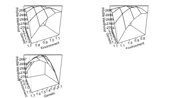

We may just be interested in creating two profile likelihood curves for
each of the scale parameters. This can be done as follows:

``` r
# first we compute data for the two profile likelihood curves staring with the
# curve for the additive genetic effect
pl_genetic <- pedmod_profile(
  ptr = ll_terms, par = opt_out$par, delta = .4, maxvls = 20000L, 
  minvls = 1000L, alpha = .05, abs_eps = 0, rel_eps = 1e-4, which_prof = 3L,
  use_aprx = TRUE, n_threads = 4L, verbose = TRUE, cluster_weights = c_weights, 
  vls_scales = sqrt(c_weights))
#> The estimate of the standard error of the log likelihood is 0.00485355. Preferably this should be below 0.001
#> 
#> Finding the lower limit of the profile likelihood curve
#> LogLike: -2697.0252 at         0.225154
#> LogLike: -2696.9823 at         0.225154
#> LogLike: -2699.9665 at        -0.174846
#> LogLike: -2699.9145 at        -0.174846
#> LogLike: -2698.2151 at         0.035090. Lb, target, ub: -2698.2151, -2698.0360, -2696.9823
#> LogLike: -2698.1092 at         0.035090. Lb, target, ub: -2698.1092, -2698.0360, -2696.9823
#> LogLike: -2697.9842 at         0.065088. Lb, target, ub: -2698.1092, -2698.0360, -2697.9842
#> LogLike: -2697.8985 at         0.065088. Lb, target, ub: -2698.1092, -2698.0360, -2697.8985
#> 
#> Finding the upper limit of the profile likelihood curve
#> LogLike: -2696.9671 at         1.025154
#> LogLike: -2696.8870 at         1.025154
#> LogLike: -2698.6619 at         1.425154
#> LogLike: -2698.5592 at         1.425154
#> LogLike: -2698.0013 at         1.283410. Lb, target, ub: -2698.5592, -2698.0360, -2698.0013
#> LogLike: -2697.9083 at         1.283410. Lb, target, ub: -2698.5592, -2698.0360, -2697.9083
#> LogLike: -2698.1910 at         1.325152. Lb, target, ub: -2698.1910, -2698.0360, -2697.9083
#> LogLike: -2698.0953 at         1.325152. Lb, target, ub: -2698.0953, -2698.0360, -2697.9083
#> LogLike: -2696.1152 at         0.625154
exp(pl_genetic$confs) # the confidence interval
#>  2.50 pct. 97.50 pct. 
#>      1.046      3.714

# compare with the Wald type
Wald <- 
  opt_out$par[3] + c(-1, 1) * qnorm(.975) * sqrt(diag(attr(hess, "vcov"))[3])
rbind(Wald = Wald, `Profile likelihood` = pl_genetic$confs)
#>                    2.50 pct. 97.50 pct.
#> Wald                 0.04808      1.202
#> Profile likelihood   0.04533      1.312

# then we compute the curve for the environment effect
pl_env <- pedmod_profile(
  ptr = ll_terms, par = opt_out$par, delta = .6, maxvls = 20000L, 
  minvls = 1000L, alpha = .05, abs_eps = 0, rel_eps = 1e-4, which_prof = 4L,
  use_aprx = TRUE, n_threads = 4L, verbose = TRUE, cluster_weights = c_weights, 
  vls_scales = sqrt(c_weights))
#> The estimate of the standard error of the log likelihood is 0.00485355. Preferably this should be below 0.001
#> 
#> Finding the lower limit of the profile likelihood curve
#> LogLike: -2697.1299 at        -0.768676
#> LogLike: -2697.0734 at        -0.768676
#> LogLike: -2699.2342 at        -1.368676
#> LogLike: -2699.1717 at        -1.368676
#> LogLike: -2698.0807 at        -1.055866. Lb, target, ub: -2698.0807, -2698.0360, -2697.0734
#> LogLike: -2698.0269 at        -1.055866. Lb, target, ub: -2699.1717, -2698.0360, -2698.0269
#> LogLike: -2698.2209 at        -1.092911. Lb, target, ub: -2698.2209, -2698.0360, -2698.0269
#> LogLike: -2698.1591 at        -1.092911. Lb, target, ub: -2698.1591, -2698.0360, -2698.0269
#> 
#> Finding the upper limit of the profile likelihood curve
#> LogLike: -2697.4796 at         0.431324
#> LogLike: -2697.3383 at         0.431324
#> LogLike: -2700.2691 at         1.031324
#> LogLike: -2700.1408 at         1.031324
#> LogLike: -2698.4963 at         0.678879. Lb, target, ub: -2698.4963, -2698.0360, -2697.3383
#> LogLike: -2698.3980 at         0.678879. Lb, target, ub: -2698.3980, -2698.0360, -2697.3383
#> LogLike: -2698.0725 at         0.587669. Lb, target, ub: -2698.0725, -2698.0360, -2697.3383
#> LogLike: -2697.9798 at         0.587669. Lb, target, ub: -2698.3980, -2698.0360, -2697.9798
#> LogLike: -2696.1152 at        -0.168676
exp(pl_env$confs) # the confidence interval
#>  2.50 pct. 97.50 pct. 
#>      0.347      1.823

# compare with the Wald type
Wald <- 
  opt_out$par[4] + c(-1, 1) * qnorm(.975) * sqrt(diag(attr(hess, "vcov"))[4])
rbind(Wald = Wald, `Profile likelihood` = pl_env$confs)
#>                    2.50 pct. 97.50 pct.
#> Wald                 -0.8983     0.5610
#> Profile likelihood   -1.0584     0.6003
```

We plot the two profile likelihood curves below:

``` r
do_plot <- function(obj, xlab, estimate, trans = function(x) exp(x / 2), 
                    max_diff = 8, add = FALSE, col = "black"){
  xs <- trans(obj$xs)
  pls <- obj$p_log_Lik
  keep <- pls > max(pls) - max_diff
  xs <- xs[keep]
  pls <- pls[keep]
  if(add)
    points(xs, pls, pch = 16, col = col)
  else {
    plot(xs, pls, bty = "l", pch = 16, xlab = xlab, ylab = "Profile likelihood", 
         col = col)
    grid()
    abline(v = estimate, lty = 2, col = col) # the estimate
    # mark the critical value
    abline(h = max(pls) - qchisq(.95, 1) / 2, lty = 3, col = col) 
  }
  
  lines(spline(xs, pls, n = 100L), col = col)
}

par(mar = c(5, 5, 1, 1))
do_plot(pl_genetic, expression(sigma[G]), exp(opt_out$par[3] / 2))
```

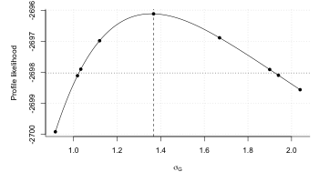

``` r
do_plot(pl_env, expression(sigma[E]), exp(opt_out$par[4] / 2))
```

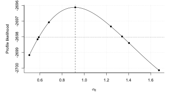

#### Profile Likelihood Curve: Proportion of Variance

Suppose that we want a profile likelihood curve for the proportion of
variance explained by each random effect. If $K = 1$ then we can use the
profile likelihood curve for $\sigma_1^2$ as the proportion of variance
for the first effect when $K = 1$ is a monotone transformation of this
parameter only and thus we can use the scale invariance of the
likelihood ratio. However, this is not true for more effects, $K > 1$.
To see this, notice that proportion of variance is given by

$$
h_i = \left(1 + \sum_{k = 1}^K\sigma_k^2\right)^{-1}\sigma_i^2\Leftrightarrow
  \sigma_i^2 =
    \frac{h_i}{1 - h_i}\left(1 + \sum_{k \in \{1,\dots,K\}\setminus\{i\}}\sigma_k^2\right)
$$

Let $l(\vec\beta, \sigma_1^2,\dots,\sigma_K^2)$ be the log likelihood.
Then the profile likelihood in the proportion of variance explained by
the effect $i$ is

$$
\tilde l_i(h_i) = \max_{\vec\beta,\sigma_1,\dots,\sigma_{k-1},\sigma_{k+1},\dots,\sigma_K}
  l\left(\vec\beta,\sigma_1,\dots,\sigma_{k-1},
  \frac{h_i}{1 - h_i}\left(1 + \sum_{k \in \{1,\dots,K\}\setminus\{i\}}\sigma_k^2\right),
  \sigma_{k+1},\dots,\sigma_K\right)
$$

As these proportions are often the interest of the analysis, the
`pedmod_profile_prop` function is implemented to produce profile
likelihood based confidence intervals for $K > 1$. We provide an example
of using `pedmod_profile_prop` below.

``` r
# confidence interval for the proportion of variance for the genetic effect
pl_genetic_prop <- pedmod_profile_prop(
  ptr = ll_terms, par = opt_out$par, maxvls = 20000L, 
  minvls = 1000L, alpha = .05, abs_eps = 0, rel_eps = 1e-4, which_prof = 1L,
  use_aprx = TRUE, n_threads = 4L, verbose = TRUE, cluster_weights = c_weights, 
  vls_scales = sqrt(c_weights))
#> The estimate of the standard error of the log likelihood is 0.00485355. Preferably this should be below 0.001
#> 
#> Finding the upper limit of the profile likelihood curve
#> LogLike: -2746.1578 at         0.990000
#> LogLike: -2746.2084 at         0.990000
#> LogLike: -2696.1152 at         0.503198
#> LogLike: -2696.9007 at         0.573879. Lb, target, ub: -2746.2084, -2698.0360, -2696.9007
#> LogLike: -2696.9005 at         0.573879. Lb, target, ub: -2746.2084, -2698.0360, -2696.9005
#> LogLike: -2699.2078 at         0.643801. Lb, target, ub: -2699.2078, -2698.0360, -2696.9005
#> LogLike: -2699.2179 at         0.643801. Lb, target, ub: -2699.2179, -2698.0360, -2696.9005
#> LogLike: -2698.0856 at         0.615037. Lb, target, ub: -2698.0856, -2698.0360, -2696.9005
#> LogLike: -2698.0797 at         0.615037. Lb, target, ub: -2698.0797, -2698.0360, -2696.9005
#> LogLike: -2697.8859 at         0.609329. Lb, target, ub: -2698.0797, -2698.0360, -2697.8859
#> LogLike: -2697.8827 at         0.609329. Lb, target, ub: -2698.0797, -2698.0360, -2697.8827
#> 
#> Finding the lower limit of the profile likelihood curve
#> LogLike: -2730.9045 at         0.010000
#> LogLike: -2730.9120 at         0.010000
#> LogLike: -2696.1152 at         0.503198
#> LogLike: -2696.9370 at         0.424199. Lb, target, ub: -2730.9120, -2698.0360, -2696.9370
#> LogLike: -2696.9449 at         0.424199. Lb, target, ub: -2730.9120, -2698.0360, -2696.9449
#> LogLike: -2699.5217 at         0.345715. Lb, target, ub: -2699.5217, -2698.0360, -2696.9449
#> LogLike: -2699.5253 at         0.345715. Lb, target, ub: -2699.5253, -2698.0360, -2696.9449
#> LogLike: -2698.1268 at         0.381905. Lb, target, ub: -2698.1268, -2698.0360, -2696.9449
#> LogLike: -2698.1258 at         0.381905. Lb, target, ub: -2698.1258, -2698.0360, -2696.9449
#> LogLike: -2697.8799 at         0.388948. Lb, target, ub: -2698.1258, -2698.0360, -2697.8799
#> LogLike: -2697.8953 at         0.388948. Lb, target, ub: -2698.1258, -2698.0360, -2697.8953
#> LogLike: -2696.1152 at         0.503198
pl_genetic_prop$confs # the confidence interval
#>  2.50 pct. 97.50 pct. 
#>     0.3846     0.6138

# confidence interval for the proportion of variance for the environment
# effect
pl_env_prop <- pedmod_profile_prop(
  ptr = ll_terms, par = opt_out$par, maxvls = 20000L, 
  minvls = 1000L, alpha = .05, abs_eps = 0, rel_eps = 1e-4, which_prof = 2L,
  use_aprx = TRUE, n_threads = 4L, verbose = TRUE, cluster_weights = c_weights,
  vls_scales = sqrt(c_weights))
#> The estimate of the standard error of the log likelihood is 0.00485355. Preferably this should be below 0.001
#> 
#> Finding the upper limit of the profile likelihood curve
#> LogLike: -3063.0772 at         0.990000
#> LogLike: -3045.1766 at         0.990000
#> LogLike: -2696.1152 at         0.227501
#> LogLike: -2697.5521 at         0.315953. Lb, target, ub: -3045.1766, -2698.0360, -2697.5521
#> LogLike: -2697.5597 at         0.315953. Lb, target, ub: -3045.1766, -2698.0360, -2697.5597
#> LogLike: -2701.2480 at         0.393170. Lb, target, ub: -2701.2480, -2698.0360, -2697.5597
#> LogLike: -2701.2467 at         0.393170. Lb, target, ub: -2701.2467, -2698.0360, -2697.5597
#> LogLike: -2698.4675 at         0.340565. Lb, target, ub: -2698.4675, -2698.0360, -2697.5597
#> LogLike: -2698.4842 at         0.340565. Lb, target, ub: -2698.4842, -2698.0360, -2697.5597
#> LogLike: -2698.0145 at         0.329342. Lb, target, ub: -2698.4842, -2698.0360, -2698.0145
#> LogLike: -2698.0311 at         0.329342. Lb, target, ub: -2698.4842, -2698.0360, -2698.0311
#> 
#> Finding the lower limit of the profile likelihood curve
#> LogLike: -2704.2329 at         0.010000
#> LogLike: -2704.2423 at         0.010000
#> LogLike: -2696.1152 at         0.227501
#> LogLike: -2696.9430 at         0.157642. Lb, target, ub: -2704.2423, -2698.0360, -2696.9430
#> LogLike: -2696.9591 at         0.157642. Lb, target, ub: -2704.2423, -2698.0360, -2696.9591
#> LogLike: -2698.8929 at         0.100249. Lb, target, ub: -2698.8929, -2698.0360, -2696.9591
#> LogLike: -2698.9071 at         0.100249. Lb, target, ub: -2698.9071, -2698.0360, -2696.9591
#> LogLike: -2697.9997 at         0.122869. Lb, target, ub: -2698.9071, -2698.0360, -2697.9997
#> LogLike: -2698.0064 at         0.122869. Lb, target, ub: -2698.9071, -2698.0360, -2698.0064
#> LogLike: -2698.1153 at         0.119594. Lb, target, ub: -2698.1153, -2698.0360, -2698.0064
#> LogLike: -2698.1260 at         0.119594. Lb, target, ub: -2698.1260, -2698.0360, -2698.0064
#> LogLike: -2696.1152 at         0.227501
pl_env_prop$confs # the confidence interval
#>  2.50 pct. 97.50 pct. 
#>     0.1220     0.3295
```

A wrong approach is to use the confidence interval for $\sigma_i^2$ to
attempt to construct a confidence interval for $h_i$. To see that this
is wrong, let

$$
\begin{aligned}
\vec v_{i}(\sigma_i^2) &=
  \text{arg max}_{\sigma_1^2,\dots,\sigma_{i  -1}^2, \sigma_{i + 1}^2,\dots,\sigma_K^2}
  \max_{\vec\beta}
  l\left(\vec\beta,\sigma_1^2,\dots,\sigma_K^2\right) \\
\vec s_i(\sigma_i^2) &=
  \left(v_{i1}(\sigma_i^2),\dots,
        v_{i,i-1}(\sigma_i^2), \sigma_i^2,
        v_{i,i+1}(\sigma_i^2),\dots,
        v_{i,K-1}(\sigma_i^2)\right)^\top
\end{aligned}
$$

Now, suppose that exists a function $g:\,(0,1)\rightarrow(0,\infty)$
such that

$$
h_i = \frac{g_i(h_i)}{1+\sum_{k = 0}^K s_{ik}(g_i(h_i))}
$$

Then it follows that

$$
\tilde l_i(h_i) \geq \max_{\vec\beta} l(\vec\beta, \vec s_i(g_i(h_i)))
$$

Thus, if one uses the profile likelihood curve of $\sigma_i^2$ to
attempt to construct a confidence interval for $h_i$ then the result is
anti-conservative. This is illustrated below where the black curves are
the proper profile likelihoods and the gray curves are the
invalid/attempted profile likelihood curves.

``` r
# using the right approach 
estimate <- exp(tail(opt_out$par, 2))
estimate <- estimate / (1 + sum(estimate))
par(mar = c(5, 5, 1, 1))
do_plot(pl_genetic_prop, expression(h[G]), estimate[1], identity)

# create curve using the wrong approach
dum_pl <- pl_genetic
dum_pl$xs <- sapply(dum_pl$data, function(x) {
  scales <- exp(c(x$x, tail(x$optim$par, 1)))
  scales[1] / (1 + sum(scales))
})
do_plot(dum_pl, expression(h[G]), estimate[1], identity, col = "gray40", 
        add = TRUE)
```

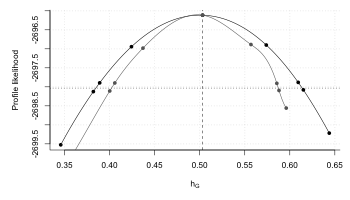

``` r
# do the same for the environment effect 
do_plot(pl_env_prop, expression(h[E]), estimate[2], identity)

dum_pl <- pl_env
dum_pl$xs <- sapply(dum_pl$data, function(x) {
  scales <- exp(c(x$x, tail(x$optim$par, 1)))
  scales[1] / (1 + sum(scales))
})
do_plot(dum_pl, expression(h[E]), estimate[2], identity, col = "gray40", 
        add = TRUE)
```

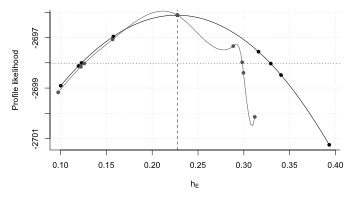

It is also possible to pass starting bounds to `pedmod_profile_prop` as
shown below.

``` r
# confidence interval for the proportion of variance for the genetic effect
pl_genetic_prop_bounds <- pedmod_profile_prop(
  ptr = ll_terms, par = opt_out$par, maxvls = 20000L, 
  minvls = 1000L, alpha = .05, abs_eps = 0, rel_eps = 1e-4, which_prof = 1L,
  use_aprx = TRUE, n_threads = 4L, verbose = TRUE, cluster_weights = c_weights, 
  vls_scales = sqrt(c_weights), bound = c(.3, .65))
#> The estimate of the standard error of the log likelihood is 0.00485355. Preferably this should be below 0.001
#> 
#> Finding the upper limit of the profile likelihood curve
#> LogLike: -2699.4910 at         0.650000
#> LogLike: -2699.5002 at         0.650000
#> LogLike: -2696.1152 at         0.503198
#> LogLike: -2696.9779 at         0.577242. Lb, target, ub: -2699.5002, -2698.0360, -2696.9779
#> LogLike: -2696.9763 at         0.577242. Lb, target, ub: -2699.5002, -2698.0360, -2696.9763
#> LogLike: -2698.0296 at         0.613455. Lb, target, ub: -2699.5002, -2698.0360, -2698.0296
#> LogLike: -2698.0244 at         0.613455. Lb, target, ub: -2699.5002, -2698.0360, -2698.0244
#> LogLike: -2698.1872 at         0.617816. Lb, target, ub: -2698.1872, -2698.0360, -2698.0244
#> LogLike: -2698.1831 at         0.617816. Lb, target, ub: -2698.1831, -2698.0360, -2698.0244
#> 
#> Finding the lower limit of the profile likelihood curve
#> LogLike: -2701.8072 at         0.300000
#> LogLike: -2701.8211 at         0.300000
#> LogLike: -2696.1152 at         0.503198
#> LogLike: -2697.0364 at         0.419820. Lb, target, ub: -2701.8211, -2698.0360, -2697.0364
#> LogLike: -2697.0466 at         0.419820. Lb, target, ub: -2701.8211, -2698.0360, -2697.0466
#> LogLike: -2698.6668 at         0.366663. Lb, target, ub: -2698.6668, -2698.0360, -2697.0466
#> LogLike: -2698.6685 at         0.366663. Lb, target, ub: -2698.6685, -2698.0360, -2697.0466
#> LogLike: -2697.9751 at         0.385995. Lb, target, ub: -2698.6685, -2698.0360, -2697.9751
#> LogLike: -2697.9907 at         0.385995. Lb, target, ub: -2698.6685, -2698.0360, -2697.9907
#> LogLike: -2698.0933 at         0.382563. Lb, target, ub: -2698.0933, -2698.0360, -2697.9907
#> LogLike: -2698.1023 at         0.382563. Lb, target, ub: -2698.1023, -2698.0360, -2697.9907
#> LogLike: -2696.1152 at         0.503198

# compare the result
pl_genetic_prop_bounds$confs
#>  2.50 pct. 97.50 pct. 
#>     0.3846     0.6138
pl_genetic_prop$confs
#>  2.50 pct. 97.50 pct. 
#>     0.3846     0.6138
```

### Simulation Study

We make a small simulation study below where we are interested in the
estimation time, bias and coverage of Wald type confidence intervals.

``` r
# the seeds we will use
seeds <- c(36451989L, 18774630L, 76585289L, 31898455L, 55733878L, 99681114L, 37725150L, 99188448L, 66989159L, 20673587L, 47985954L, 42571905L, 53089211L, 18457743L, 96049437L, 70222325L, 86393368L, 45380572L, 81116968L, 48291155L, 89755299L, 69891073L, 1846862L, 15263013L, 37537710L, 
           25194071L, 14471551L, 38278606L, 55596031L, 5436537L, 75008107L, 83382936L, 50689482L, 71708788L, 52258337L, 23423931L, 61069524L, 24452554L, 32406673L, 14900280L, 24818537L, 59733700L, 82407492L, 95500692L, 62528680L, 88728797L, 9891891L, 36354594L, 69630736L, 41755287L)

# run the simulation study
sim_study <- lapply(seeds, function(s){
  set.seed(s)
  
  # only run the result if it has not been computed
  f <- file.path("cache", "sim_study_simple_w_env", 
                 paste0("simple-w-env-", s, ".RDS"))
  if(!file.exists(f)){
    # simulate the data
    dat <- sim_dat(n_fams = 1000L)
    
    # get the weighted data set
    dat_unqiue <- dat[!duplicated(dat)]
    attributes(dat_unqiue) <- attributes(dat)
    c_weights <- sapply(dat_unqiue, function(x)
      sum(sapply(dat, identical, y = x)))
    rm(dat)
    
    # get the starting values
    library(pedmod)
    do_fit <- function(standardized){
      ll_terms <- pedigree_ll_terms(dat_unqiue, max_threads = 4L)
      ti_start <- system.time(start <- pedmod_start(
        ptr = ll_terms, data = dat_unqiue, n_threads = 4L, 
        cluster_weights = c_weights, standardized = standardized,
        vls_scales = sqrt(c_weights)))
      start$time <- ti_start
      
      # fit the model
      ti_quick <- system.time(
        opt_out_quick <- pedmod_opt(
          ptr = ll_terms, par = start$par, maxvls = 5000L, abs_eps = 0, 
          rel_eps = 1e-2, minvls = 500L, use_aprx = TRUE, n_threads = 4L, 
          cluster_weights = c_weights, standardized = standardized,
          vls_scales = sqrt(c_weights)))
      opt_out_quick$time <- ti_quick
      
      ti_slow <- system.time(
        opt_out <- pedmod_opt(
          ptr = ll_terms, par = opt_out_quick$par, abs_eps = 0, use_aprx = TRUE, 
          n_threads = 4L, cluster_weights = c_weights,
           standardized = standardized, vls_scales = sqrt(c_weights),
          # we changed these parameters
          maxvls = 25000L, rel_eps = 1e-3, minvls = 5000L))
      opt_out$time <- ti_slow
      
      if(standardized){
        start$par     <- standardized_to_direct(start$par        , 2L)
        opt_out$par   <- standardized_to_direct(opt_out$par      , 2L)
        opt_out_quick$par <- standardized_to_direct(opt_out_quick$par, 2L)
      }
      
      if(!standardized){
        hess_time <- system.time(
          hess <- eval_pedigree_hess(
            ptr = ll_terms, par = opt_out$par, maxvls = 25000L, 
            abs_eps = 0, minvls = 5000L, use_aprx = TRUE, 
            rel_eps = 1e-4, n_threads = 4L, cluster_weights = c_weights,
            vls_scales = sqrt(c_weights)))
        attr(hess, "time") <- hess_time
      } else
        hess <- NULL
      
      list(start = start, opt_out = opt_out, opt_out_quick = opt_out_quick, 
           ll_no_rng = start$logLik_no_rng, hess = hess)
    }
    
    fit_direct <- do_fit(standardized = FALSE)
    fit_std    <- do_fit(standardized = TRUE)
    
    saveRDS(list(fit_direct = fit_direct, fit_std = fit_std), f)
  }
  
  # report to console and return 
  out <- readRDS(f)
  message(paste0(capture.output(out$fit_direct$opt_out$par), collapse = "\n"))
  message(paste0(capture.output(out$fit_std   $opt_out$par), collapse = "\n"))
  
  par <- out$fit_direct$opt_out$par
  SEs <- sqrt(diag(attr(out$fit_direct$hess, "vcov")))
  
  message(paste0(capture.output(rbind(
    Estimate = par, SE = SEs)), collapse = "\n"))
  message(sprintf(
    "Time %12.1f, %12.1f. Max ll: %12.4f, %12.4f\n",
    with(out$fit_direct, start$time["elapsed"] + opt_out$time["elapsed"] +
           opt_out_quick$time["elapsed"]),
    with(out$fit_std   , start$time["elapsed"] + opt_out$time["elapsed"]  +
           opt_out_quick$time["elapsed"]),
    -out$fit_direct$opt_out$value,
    -out$fit_std   $opt_out$value))
  
  out
})

# gather the estimates
beta_est <- sapply(sim_study, function(x) 
  cbind(Direct       = head(x$fit_direct$opt_out$par, 2), 
        Standardized = head(x$fit_std   $opt_out$par, 2)), 
  simplify = "array")
sigma_est <- sapply(sim_study, function(x) 
  cbind(Direct       = exp(tail(x$fit_direct$opt_out$par, 2) / 2), 
        Standardized = exp(tail(x$fit_std   $opt_out$par, 2) / 2)), 
  simplify = "array")

# compute the errors
tmp <- sim_dat(2L)
err_beta  <- beta_est  - attr(tmp, "beta")
err_sigma <- sigma_est - sqrt(attr(tmp, "sig_sq"))
dimnames(err_sigma)[[1L]] <- c("std genetic", "std env.")
err <- abind::abind(err_beta, err_sigma, along = 1)

# get the bias estimates and the standard errors
bias <- apply(err, 1:2, mean)
n_sims <- dim(err)[[3]]
SE <- apply(err , 1:2, sd) / sqrt(n_sims)
bias
#>               Direct Standardized
#> (Intercept) -0.05771     -0.06245
#> Binary       0.08444      0.09080
#> std genetic  0.02379      0.02665
#> std env.     0.03156      0.03325
SE
#>              Direct Standardized
#> (Intercept) 0.06111      0.06343
#> Binary      0.08392      0.08681
#> std genetic 0.03909      0.04013
#> std env.    0.02853      0.02965

# make a box plot
b_vals <- expand.grid(rownames(err), strtrim(colnames(err), 1))
box_dat <- data.frame(Error = c(err), 
                      Parameter = rep(b_vals$Var1, n_sims), 
                      Method = rep(b_vals$Var2, dim(err)[[3]]))
par(mar = c(7, 5, 1, 1))
# S is for the standardized and D is for the direct parameterization
boxplot(Error ~ Method + Parameter, box_dat, ylab = "Error", las = 2, 
        xlab = "")
abline(h = 0, lty = 2)
grid()
```

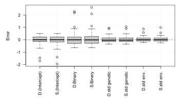

``` r
# get the average computation times
time_vals <- sapply(sim_study, function(x) {
  . <- function(z){
    keep <- c("opt_out", "start")
    out <- setNames(sapply(z[keep], function(z) z$time["elapsed"]), keep)
    c(out, total = sum(out))
  }
  
  rbind(Direct       = .(x$fit_direct), 
        Standardized = .(x$fit_std))
}, simplify = "array")
apply(time_vals, 1:2, mean)
#>              opt_out start total
#> Direct         7.169 1.796 8.966
#> Standardized   5.962 1.706 7.668
apply(time_vals, 1:2, sd)
#>              opt_out  start total
#> Direct         4.122 0.7453 4.156
#> Standardized   4.092 0.8929 4.467
apply(time_vals, 1:2, quantile)
#> , , opt_out
#> 
#>      Direct Standardized
#> 0%    0.771        0.759
#> 25%   4.350        3.639
#> 50%   7.598        6.567
#> 75%   9.926        7.600
#> 100% 20.060       25.869
#> 
#> , , start
#> 
#>      Direct Standardized
#> 0%    0.801        0.809
#> 25%   1.266        1.219
#> 50%   1.443        1.320
#> 75%   2.280        1.896
#> 100%  4.071        4.536
#> 
#> , , total
#> 
#>      Direct Standardized
#> 0%    2.142        1.976
#> 25%   6.145        5.220
#> 50%   9.272        8.182
#> 75%  11.319        9.833
#> 100% 21.241       30.405

# get the standardized errors
ers_sds <- sapply(sim_study, function(x){
  par <- x$fit_direct$opt_out$par
  err <- par - c(attr(tmp, "beta"), log(attr(tmp, "sig_sq")))
  SEs <- sqrt(diag(solve(-x$fit_direct$hess)))
  
  err / SEs
})

rowMeans(abs(ers_sds) < qnorm(.95)) # 90% coverage
#> (Intercept)      Binary                         
#>        0.86        0.88        0.90        0.94
rowMeans(abs(ers_sds) < qnorm(.975)) # 95% coverage
#> (Intercept)      Binary                         
#>        0.94        0.90        0.92        0.96
rowMeans(abs(ers_sds) < qnorm(.995)) # 99% coverage
#> (Intercept)      Binary                         
#>        1.00        1.00        1.00        0.98

# stats for the computation time of the Hessian
hess_time <- sapply(
  sim_study, function(x) attr(x$fit_direct$hess, "time")["elapsed"])
mean(hess_time)
#> [1] 1.506
quantile(hess_time, probs = seq(0, 1, .1))
#>    0%   10%   20%   30%   40%   50%   60%   70%   80%   90%  100% 
#> 1.336 1.439 1.453 1.477 1.496 1.505 1.519 1.535 1.556 1.585 1.619

# compute the coverage on the standardized scale with the proportion of 
# variances
ers_sds <- sapply(sim_study, function(x){
  par_n_vcov <- std_prop_estimates(
    x$fit_direct$opt_out$par, 2L, x$fit_direct$hess)
  truth <- std_prop_estimates(c(attr(tmp, "beta"), log(attr(tmp, "sig_sq"))), 2)
  (par_n_vcov$par - truth$par) / sqrt(diag(par_n_vcov$vcov_var))
})

rowMeans(abs(ers_sds) < qnorm(.95)) # 90% coverage
#> (Intercept)      Binary                         
#>        0.96        0.94        0.88        0.92
rowMeans(abs(ers_sds) < qnorm(.975)) # 95% coverage
#> (Intercept)      Binary                         
#>        1.00        0.98        0.96        0.98
rowMeans(abs(ers_sds) < qnorm(.995)) # 99% coverage
#> (Intercept)      Binary                         
#>        1.00        0.98        1.00        1.00
```

## Individual Specific Loadings

The models have used till now are in this form

$$
\begin{aligned}
 Y_{ij} &= \begin{cases} 1 & \vec x_{ij}^\top\vec\beta +
   R_{ij} + \sum_{k = 1}^K \sigma_kU_{ikj} > 0 \\
   0 & \text{otherwise} \end{cases} \\
 (U_{ik1}, \dots,  U_{ikn_i})^\top &\sim N^{(n_i)}(\vec 0, C_{ik}) \\
 R_{ij} &\sim N(0, 1)\end{aligned}
$$

for known fixed effects covariates $\vec x_{ij}$ and scale matrices
$C_{ij}$. The $U_{ikj}$ is the $k$’th effect on individual $j$ in
cluster $i$. For instance, this could be the genetic effect or an
environmental effect.

We may consider the case where all individuals load differently on each
of the random effects. A model to incorporate such effects is

$$
\begin{aligned}
 Y_{ij} &= \begin{cases} 1 & \vec x_{ij}^\top\vec\beta +
   R_{ij} + \sum_{k = 1}^K \sigma_k(\vec z_{ij})U_{ikj} > 0 \\
   0 & \text{otherwise} \end{cases} \\
 \sigma_k(\vec z_{ij}) &= \exp(\vec\theta_k^\top\vec z_{ij}) \\
 (U_{ik1}, \dots,  U_{ikn_i})^\top &\sim N^{(n_i)}(\vec 0, C_{ik}) \\
 R_{ij} &\sim N(0, 1)\end{aligned}
$$

where the $\vec z_{ij}$ are known covariates. If all the scale matrices
are correlation matrices, then this implies that the proportion of
variance attributable to the $l$’th effect for individual $j$ in cluster
$i$ is

$$
\frac{\sigma_l^2(\vec z_{ij})^2}{1 + \sum_{k = 1}^K\sigma_k^2(\vec z_{ij})^2}
$$

rather than

$$
\frac{\sigma_l^2}{1 + \sum_{k = 1}^K\sigma_k^2}.
$$

The model can equivalent be written as

$$
\begin{aligned}
 Y_{ij} &= \begin{cases} 1 & \vec x_{ij}^\top\vec\beta +
   \epsilon_{ij} > 0 \\
   0 & \text{otherwise} \end{cases} \\
 \sigma_k(\vec z_{ij}) &= \exp(\vec\theta_k^\top\vec z_{ij}) \\
 D_{ik} &= \text{diag}(\sigma_k(\vec z_{i1}), \dots, \sigma_k(\vec z_{in_i}))\\
 (\epsilon_{i1}, \dots,  \epsilon_{in_i})^\top &\sim
   N^{(n_i)}\left(\vec 0, I + \sum_{k = 1}^K D_{ik}C_{ik}D_{ik}\right)\end{aligned}
$$

where $\text{diag}(\cdots)$ returns a diagonal matrix. This form is
useful for simulations.

As en example, we extend our previous simulation to

$$
\begin{aligned}
 Y_{ij} &= \begin{cases} 1 & \beta_0 + \beta_1 B_{ij} + \sigma_E(\vec z_{ij})E_{ij} + \sigma_G(\vec z_{ij})G_{ij} + R_{ij} > 0 \\ 0 & \text{otherwise} \end{cases} \\
 B_{ij} &\sim \text{Bin}(0.1, 1) \\
 (G_{i1}, \dots, G_{in_{i}})^\top &\sim N^{(n_i)}(\vec 0, C_{i1}) \\
(E_{i1}, \dots, E_{in_{i}})^\top &\sim N^{(n_i)}(\vec 0, C_{i2}) \\
 R_{ij} &\sim N(0, 1)\end{aligned}
$$

where $\vec z_{ij}$ is a vector containing an intercept, an indicator
for whether the individual is a male, and a covariate between minus one
and one. We will let the heritability for males be larger than for
females but the environmental effect will be the same given the second
covariate.

We assign the new simulation function below:

``` r
# the covariates for the scale parameters, Z
vcov_covs <- cbind(intercept = rep(1, 10), is_male = rep(1:0, 5), 
                   cov = seq(-1, 1, length.out = 10))
vcov_covs
#>       intercept is_male     cov
#>  [1,]         1       1 -1.0000
#>  [2,]         1       0 -0.7778
#>  [3,]         1       1 -0.5556
#>  [4,]         1       0 -0.3333
#>  [5,]         1       1 -0.1111
#>  [6,]         1       0  0.1111
#>  [7,]         1       1  0.3333
#>  [8,]         1       0  0.5556
#>  [9,]         1       1  0.7778
#> [10,]         1       0  1.0000

# set the parameters we will use
beta <- c(-2, 4)
thetas <- matrix(c(-0.394228680182135, 1.12739721457885, 1,
                   -0.50580045583924, 0.64964149206513, -1), 3)

# we can compute the individual specific proportion of variances as follows
scales <- exp(vcov_covs %*% thetas)
cbind(scales^2, 1) / rowSums(cbind(scales^2, 1))
#>          [,1]    [,2]    [,3]
#>  [1,] 0.05127 0.86131 0.08742
#>  [2,] 0.03404 0.61120 0.35477
#>  [3,] 0.22025 0.62536 0.15440
#>  [4,] 0.12019 0.36478 0.51503
#>  [5,] 0.56559 0.27142 0.16300
#>  [6,] 0.30538 0.15664 0.53797
#>  [7,] 0.83362 0.06761 0.09877
#>  [8,] 0.55221 0.04787 0.39992
#>  [9,] 0.94125 0.01290 0.04585
#> [10,] 0.76197 0.01116 0.22687

# the heritability differs between males and females but the environmental 
# effect is the same given the second covariate as shown below
vcov_covs_tmp <- vcov_covs
vcov_covs_tmp[, 3] <- 0
scales <- exp(vcov_covs_tmp %*% thetas)
cbind(scales^2, 1) / rowSums(cbind(scales^2, 1))
#>       [,1] [,2] [,3]
#>  [1,] 0.65  0.2 0.15
#>  [2,] 0.25  0.2 0.55
#>  [3,] 0.65  0.2 0.15
#>  [4,] 0.25  0.2 0.55
#>  [5,] 0.65  0.2 0.15
#>  [6,] 0.25  0.2 0.55
#>  [7,] 0.65  0.2 0.15
#>  [8,] 0.25  0.2 0.55
#>  [9,] 0.65  0.2 0.15
#> [10,] 0.25  0.2 0.55

# simulates a data set. 
# 
# Args:
#   n_fams: number of families.
#   beta: the fixed effect coefficients.
#   thetas: the coefficients for the scale parameters.
sim_dat <- function(n_fams, beta, thetas){
  # setup before the simulations
  Cmat <- 2 * kinship(ped)
  n_obs <- NROW(fam)
  
  scales <- exp(vcov_covs %*% thetas)
  Sig <- diag(n_obs) + diag(scales[, 1]) %*% Cmat %*% diag(scales[, 1]) + 
    diag(scales[, 2]) %*% C_env %*% diag(scales[, 2])
  Sig_chol <- chol(Sig)
  
  # simulate the data
  out <- replicate(
    n_fams, {
      # simulate covariates
      X <- cbind(`(Intercept)` = 1, Binary = runif(n_obs) > .9)
      
      # assign the linear predictor + noise
      eta <- drop(X %*% beta) + drop(rnorm(n_obs) %*% Sig_chol)
      
      # return the list in the format needed for the package. We also have to 
      # pass the covariates for the scale parameters
      list(y = as.numeric(eta > 0), X = X, Z = vcov_covs, scale_mats = list(
        Genetic = Cmat, Environment = C_env))
    }, simplify = FALSE)
  
  # add attributes with the true values and return 
  attributes(out) <- list(beta = beta, thetas = thetas)
  out
}
```

A data set is sampled below and the model is estimated.

``` r
# simulate a data set
set.seed(72466753)
dat <- sim_dat(n_fams = 1000L, beta = beta, thetas = thetas)

# evaluate the log marginal likelihood at the true parameters
library(pedmod)
ll_terms_wo_weights <- pedigree_ll_terms_loadings(dat, max_threads = 4L)

logLik_truth <- eval_pedigree_ll(
  ll_terms_wo_weights, c(beta, thetas), maxvls = 25000L, minvls = 1000L, 
  abs_eps = 0, rel_eps = 1e-3, n_threads = 4L)

# remove the duplicated terms and use weights. This can be done more efficiently
# and may not catch all duplicates
dat_unqiue <- dat[!duplicated(dat)]
length(dat_unqiue) # number of unique terms
#> [1] 633

# get the weights. This can be written in a much more efficient way
c_weights <- sapply(dat_unqiue, function(x)
  sum(sapply(dat, identical, y = x)))

# evaluate log likelihood again and show that we got the same
ll_terms <- pedigree_ll_terms_loadings(dat_unqiue, max_threads = 4L)

logLik_truth_weighted <- eval_pedigree_ll(
  ll_terms, c(beta, thetas), maxvls = 25000L, minvls = 1000L, 
  abs_eps = 0, rel_eps = 1e-3, n_threads = 4L, cluster_weights = c_weights)

print(logLik_truth_weighted, digits = 8)
#> [1] -4373.3542
#> attr(,"n_fails")
#> [1] 0
#> attr(,"std")
#> [1] 0.019336072
print(logLik_truth, digits = 8)
#> [1] -4373.3585
#> attr(,"n_fails")
#> [1] 0
#> attr(,"std")
#> [1] 0.0064573353

# note that the variance is greater for the weighted version
ll_ests <- sapply(1:50, function(seed){
  set.seed(seed)
  eval_pedigree_ll(
    ll_terms_wo_weights, c(beta, thetas), maxvls = 10000L, minvls = 1000L, 
    abs_eps = 0, rel_eps = 1e-3, n_threads = 4L)
})
ll_ests_fast <- sapply(1:50, function(seed){
  set.seed(seed)
  eval_pedigree_ll(
    ll_terms, c(beta, thetas), maxvls = 10000L, minvls = 1000L, 
    abs_eps = 0, rel_eps = 1e-3, n_threads = 4L, cluster_weights = c_weights)
})

# the estimates are comparable
c(`Without weights` = mean(ll_ests), `With weights` = mean(ll_ests_fast))
#> Without weights    With weights 
#>           -4373           -4373

# the standard deviation is different
c(`Without weights` = sd(ll_ests), `With weights` = sd(ll_ests_fast))
#> Without weights    With weights 
#>        0.009941        0.032046

# we can mitigate this by using the vls_scales argument which though is a bit 
# slower
ll_ests_fast_vls_scales <- sapply(1:50, function(seed){
  set.seed(seed)
  eval_pedigree_ll(
    ll_terms, c(beta, thetas), maxvls = 10000L, minvls = 1000L, 
    abs_eps = 0, rel_eps = 1e-3, n_threads = 4L, cluster_weights = c_weights, 
    vls_scales = sqrt(c_weights))
})

# the estimates are comparable
c(`Without weights` = mean(ll_ests), `With weights` = mean(ll_ests_fast), 
  `With weights and vls_scales` = mean(ll_ests_fast_vls_scales))
#>             Without weights                With weights 
#>                       -4373                       -4373 
#> With weights and vls_scales 
#>                       -4373

# the standard deviation is different
c(`Without weights` = sd(ll_ests), `With weights` = sd(ll_ests_fast), 
  `With weights and vls_scales` = sd(ll_ests_fast_vls_scales))
#>             Without weights                With weights 
#>                    0.009941                    0.032046 
#> With weights and vls_scales 
#>                    0.010431

# get the starting values
system.time(start <- pedmod_start_loadings(
  ll_terms, data = dat_unqiue, cluster_weights = c_weights))
#>    user  system elapsed 
#>   0.006   0.002   0.008

# find the maximum likelihood estimator
system.time(
  opt_res <- pedmod_opt(
    ll_terms, par = start$par, maxvls = 25000L, minvls = 5000L, 
    abs_eps = 0, rel_eps = 1e-3, n_threads = 4L, use_aprx = TRUE, 
    cluster_weights = c_weights, vls_scales = sqrt(c_weights)))
#>    user  system elapsed 
#> 275.907   0.261  85.026
```

We compare the maximum likelihood estimator with the true values below.

``` r
# the fixed effects
rbind(Truth = beta, 
      Start = head(start$par, 2), 
      Estimate = head(opt_res$par, 2))
#>          (Intercept) Binary
#> Truth         -2.000  4.000
#> Start         -1.102  2.184
#> Estimate      -2.105  4.282

# the scale coefficients
array(c(thetas, tail(start$par, -2), tail(opt_res$par, -2)), 
      dim = c(dim(thetas), 3L), 
      dimnames = list(NULL, NULL, c("Truth", "Start", "Estimate")))
#> , , Truth
#> 
#>         [,1]    [,2]
#> [1,] -0.3942 -0.5058
#> [2,]  1.1274  0.6496
#> [3,]  1.0000 -1.0000
#> 
#> , , Start
#> 
#>            [,1]       [,2]
#> [1,] -6.931e-01 -6.931e-01
#> [2,]  1.801e-15  1.801e-15
#> [3,] -2.702e-15 -2.702e-15
#> 
#> , , Estimate
#> 
#>        [,1]    [,2]
#> [1,] -0.305 -0.4726
#> [2,]  1.095  0.5476
#> [3,]  1.020 -1.1924

# compare the proportion of variance for the individual. First the estimates
thetas_est <- matrix(tail(opt_res$par, -2), NCOL(vcov_covs))
scales <- exp(vcov_covs %*% thetas_est)
cbind(scales^2, 1) / rowSums(cbind(scales^2, 1))
#>          [,1]     [,2]    [,3]
#>  [1,] 0.04432 0.885480 0.07020
#>  [2,] 0.03093 0.690869 0.27820
#>  [3,] 0.22545 0.630321 0.14423
#>  [4,] 0.12890 0.402874 0.46823
#>  [5,] 0.60620 0.237165 0.15663
#>  [6,] 0.34431 0.150582 0.50511
#>  [7,] 0.86274 0.047231 0.09003
#>  [8,] 0.60471 0.037007 0.35828
#>  [9,] 0.95256 0.007297 0.04014
#> [10,] 0.80138 0.006863 0.19176

# then the true proportions
scales <- exp(vcov_covs %*% thetas)
cbind(scales^2, 1) / rowSums(cbind(scales^2, 1))
#>          [,1]    [,2]    [,3]
#>  [1,] 0.05127 0.86131 0.08742
#>  [2,] 0.03404 0.61120 0.35477
#>  [3,] 0.22025 0.62536 0.15440
#>  [4,] 0.12019 0.36478 0.51503
#>  [5,] 0.56559 0.27142 0.16300
#>  [6,] 0.30538 0.15664 0.53797
#>  [7,] 0.83362 0.06761 0.09877
#>  [8,] 0.55221 0.04787 0.39992
#>  [9,] 0.94125 0.01290 0.04585
#> [10,] 0.76197 0.01116 0.22687

# the log likelihood at the true parameters and at the estimate
print(logLik_truth_weighted, digits = 8)
#> [1] -4373.3542
#> attr(,"n_fails")
#> [1] 0
#> attr(,"std")
#> [1] 0.019336072
print(-opt_res$value, digits = 8)
#> [1] -4370.6815
```

### Profile Likelihood

We can construct a profile likelihood for the parameters like before.
For instance, we can look at the scale parameter for the heritability
shift for the males with the following code.

``` r
system.time(
  pl_curve <- pedmod_profile(
    ll_terms, par = opt_res$par, maxvls = 25000L, minvls = 5000L, 
    abs_eps = 0, rel_eps = 1e-3, n_threads = 4L, use_aprx = TRUE, 
    cluster_weights = c_weights, vls_scales = sqrt(c_weights), 
    delta = .2, verbose = TRUE, which_prof = 4L))
#> The estimate of the standard error of the log likelihood is 0.00189664. Preferably this should be below 0.001
#> 
#> Finding the lower limit of the profile likelihood curve
#> LogLike: -4374.9109 at         0.894953
#> LogLike: -4373.9115 at         0.894953
#> LogLike: -4370.6815 at         1.094953
#> LogLike: -4371.7804 at         0.989239. Lb, target, ub: -4373.9115, -4372.6022, -4371.7804
#> LogLike: -4371.4939 at         0.989239. Lb, target, ub: -4373.9115, -4372.6022, -4371.4939
#> LogLike: -4372.8734 at         0.937691. Lb, target, ub: -4372.8734, -4372.6022, -4371.4939
#> LogLike: -4372.5926 at         0.937691. Lb, target, ub: -4373.9115, -4372.6022, -4372.5926
#> LogLike: -4372.9987 at         0.932610. Lb, target, ub: -4372.9987, -4372.6022, -4372.5926
#> LogLike: -4372.7283 at         0.932610. Lb, target, ub: -4372.7283, -4372.6022, -4372.5926
#> 
#> Finding the upper limit of the profile likelihood curve
#> LogLike: -4373.2335 at         1.294953
#> LogLike: -4373.1099 at         1.294953
#> LogLike: -4370.6815 at         1.094953
#> LogLike: -4371.9157 at         1.235563. Lb, target, ub: -4373.1099, -4372.6022, -4371.9157
#> LogLike: -4371.9529 at         1.235563. Lb, target, ub: -4373.1099, -4372.6022, -4371.9529
#> LogLike: -4372.5867 at         1.268475. Lb, target, ub: -4373.1099, -4372.6022, -4372.5867
#> LogLike: -4372.5552 at         1.268475. Lb, target, ub: -4373.1099, -4372.6022, -4372.5552
#> LogLike: -4370.6815 at         1.094953
#>     user   system  elapsed 
#> 1091.778    0.925  276.246
```

The confidence interval is shown below along with a plot of the profile
likelihood curve.

``` r
pl_curve$confs # the confidence interval
#>  2.50 pct. 97.50 pct. 
#>     0.9373     1.2708

# plot the profile likelihood curve
local({
  max_diff <- 4
  xs <- pl_curve$xs
  pls <- pl_curve$p_log_Lik
  keep <- pls > max(pls) - max_diff
  xs <- xs[keep]
  pls <- pls[keep]

  par(mar = c(5, 5, 1, 1))  
  plot(xs, pls, bty = "l", pch = 16, xlab = expression(theta[2]), 
       ylab = "Profile likelihood")
  grid()
  abline(v = opt_res$par[4], lty = 2) # the estimate
  # mark the critical value
  abline(h = max(pls) - qchisq(.95, 1) / 2, lty = 3) 
  
  lines(spline(xs, pls, n = 100L))
})
```

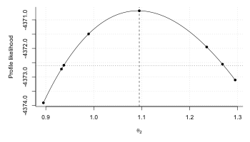

Some of the quantities of interest are nonlinear functions of the
parameters, however. For instance, we may be interested in the
difference in the proportion of variance for males at `cov = 0`. We can
construct a profile likelihood based confidence interval for this
difference but this requires an optimizer that supports nonlinear
equality constraints. The `pedmod_profile_nleq` function is created for
this purpose and an example of using it to compute the aforementioned
difference is shown below.

``` r
# computes the difference between the male and females heritability at 
# cov = 0
heq <- function(par){
  theta <- matrix(tail(par, 6), 3)
  scs <- matrix(c(1, 1, 0, 1, 0, 0), 2) %*% theta
  scs <- exp(scs)
  prop_genetic <- scs[, 1]^2 / (1 + rowSums(scs^2))
  diff(prop_genetic)
}
heq(opt_res$par)
#> [1] 0.4107

# construct the profile likelihood curve
system.time(
  pl_curve_nleq <- pedmod_profile_nleq(
    ll_terms, par = opt_res$par, maxvls = 5000L, minvls = 1000L, 
    minvls_start = 500L, maxvls_start = 500L,
    abs_eps = 0, rel_eps = 1e-3, n_threads = 4L, use_aprx = TRUE, 
    cluster_weights = c_weights, vls_scales = sqrt(c_weights), 
    delta = .2, verbose = TRUE, heq = heq, heq_bounds = c(-1, 1)))
#> The estimate of the standard error of the log likelihood is 0.00814429. Preferably this should be below 0.001
#> 
#> Finding the upper limit of the profile likelihood curve
#> LogLike: -4385.8001 at         0.610651
#> LogLike: -4385.8022 at         0.610651
#> LogLike: -4370.6861 at         0.410651
#> LogLike: -4371.3423 at         0.455463. Lb, target, ub: -4385.8022, -4372.6068, -4371.3423
#> LogLike: -4371.3155 at         0.455463. Lb, target, ub: -4385.8022, -4372.6068, -4371.3155
#> LogLike: -4374.2588 at         0.513399. Lb, target, ub: -4374.2588, -4372.6068, -4371.3155
#> LogLike: -4374.2560 at         0.513399. Lb, target, ub: -4374.2560, -4372.6068, -4371.3155
#> LogLike: -4372.7176 at         0.488937. Lb, target, ub: -4372.7176, -4372.6068, -4371.3155
#> LogLike: -4372.6888 at         0.488937. Lb, target, ub: -4372.6888, -4372.6068, -4371.3155
#> LogLike: -4372.4552 at         0.483824. Lb, target, ub: -4372.6888, -4372.6068, -4372.4552
#> LogLike: -4372.4248 at         0.483824. Lb, target, ub: -4372.6888, -4372.6068, -4372.4248
#> 
#> Finding the lower limit of the profile likelihood curve
#> LogLike: -4379.4648 at         0.210651
#> LogLike: -4379.4468 at         0.210651
#> LogLike: -4370.6861 at         0.410651
#> LogLike: -4371.6444 at         0.349452. Lb, target, ub: -4379.4468, -4372.6068, -4371.6444
#> LogLike: -4371.6290 at         0.349452. Lb, target, ub: -4379.4468, -4372.6068, -4371.6290
#> LogLike: -4373.5286 at         0.303085. Lb, target, ub: -4373.5286, -4372.6068, -4371.6290
#> LogLike: -4373.5118 at         0.303085. Lb, target, ub: -4373.5118, -4372.6068, -4371.6290
#> LogLike: -4372.6151 at         0.323028. Lb, target, ub: -4372.6151, -4372.6068, -4371.6290
#> LogLike: -4372.5879 at         0.323028. Lb, target, ub: -4373.5118, -4372.6068, -4372.5879
#> LogLike: -4372.7216 at         0.320401. Lb, target, ub: -4372.7216, -4372.6068, -4372.5879
#> LogLike: -4372.6921 at         0.320401. Lb, target, ub: -4372.6921, -4372.6068, -4372.5879
#> LogLike: -4370.6861 at         0.410651
#>     user   system  elapsed 
#> 1722.919    1.994  481.037
```

The confidence interval is shown below along with a plot of the profile
likelihood curve.

``` r
pl_curve_nleq$confs # the confidence interval
#>  2.50 pct. 97.50 pct. 
#>     0.3225     0.4874

# plot the profile likelihood curve
local({
  max_diff <- 4
  xs <- pl_curve_nleq$xs
  pls <- pl_curve_nleq$p_log_Lik
  keep <- pls > max(pls) - max_diff
  xs <- xs[keep]
  pls <- pls[keep]

  par(mar = c(5, 5, 1, 1))  
  plot(xs, pls, bty = "l", pch = 16, ylab = "Profile likelihood",
       xlab = "Heritability difference at cov = 0")
  grid()
  abline(v = opt_res$par[4], lty = 2) # the estimate
  # mark the critical value
  abline(h = max(pls) - qchisq(.95, 1) / 2, lty = 3) 
  
  lines(spline(xs, pls, n = 100L))
})
```

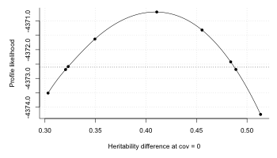

### Simulation Study

We make a small simulation study below where we are interested in the
estimation time and bias.

``` r
# the seeds we will use
seeds <- c(36451989L, 18774630L, 76585289L, 31898455L, 55733878L, 99681114L, 37725150L, 99188448L, 66989159L, 20673587L, 47985954L, 42571905L, 53089211L, 18457743L, 96049437L, 70222325L, 86393368L, 45380572L, 81116968L, 48291155L, 89755299L, 69891073L, 1846862L, 15263013L, 37537710L, 
           25194071L, 14471551L, 38278606L, 55596031L, 5436537L, 75008107L, 83382936L, 50689482L, 71708788L, 52258337L, 23423931L, 61069524L, 24452554L, 32406673L, 14900280L, 24818537L, 59733700L, 82407492L, 95500692L, 62528680L, 88728797L, 9891891L, 36354594L, 69630736L, 41755287L)

# run the simulation study
sim_study <- lapply(seeds, function(s){
  set.seed(s)
  
  # only run the result if it has not been computed
  f <- file.path("cache", "sim_study_loadings", 
                 paste0("loadings-", s, ".RDS"))
  if(!file.exists(f)){
    # simulate the data
    dat <- sim_dat(n_fams = 1000L, beta = beta, thetas = thetas)
    
    # get the weighted data set
    dat_unqiue <- dat[!duplicated(dat)]
    attributes(dat_unqiue) <- attributes(dat)
    c_weights <- sapply(dat_unqiue, function(x)
      sum(sapply(dat, identical, y = x)))
    rm(dat)
    
    # get the starting values
    library(pedmod)
    ll_terms <- pedigree_ll_terms_loadings(dat_unqiue, max_threads = 4L)
    
    # fit the model
    ti_start <- system.time(start <- pedmod_start_loadings(
        ptr = ll_terms, data = dat_unqiue, cluster_weights = c_weights))
    start$time <- ti_start
    
    ti_quick <- system.time(
      opt_out_quick <- pedmod_opt(
        ptr = ll_terms, par = start$par, maxvls = 5000L, abs_eps = 0, 
        rel_eps = 1e-2, minvls = 500L, use_aprx = TRUE, n_threads = 4L, 
        cluster_weights = c_weights, vls_scales = sqrt(c_weights)))
    opt_out_quick$time <- ti_quick
    
    ti_slow <- system.time(
      opt_out <- pedmod_opt(
        ptr = ll_terms, par = opt_out_quick$par, abs_eps = 0, use_aprx = TRUE, 
        n_threads = 4L, cluster_weights = c_weights, 
        vls_scales = sqrt(c_weights),
        # we changed these parameters
        maxvls = 25000L, rel_eps = 1e-3, minvls = 5000L))
    opt_out$time <- ti_slow
    
    saveRDS(list(start = start, opt_out_quick = opt_out_quick, 
                 opt_out = opt_out), f)
    
  }
  
  # report to console and return 
  out <- readRDS(f)
  message(paste0(capture.output(
    rbind(Estimate = out$opt_out$par, Truth = c(beta, thetas))), 
    collapse = "\n"))

  message(sprintf(
    "Time %12.1f. Max ll: %12.4f\n",
    with(out, start$time["elapsed"] + opt_out$time["elapsed"] +
           opt_out_quick$time["elapsed"]),
    -out$opt_out$value))
  
  out
})

# compute the bias estimates
estimates <- sapply(sim_study, function(x) x$opt_out$par)
rownames(estimates) <- c("(Intercept)", "Binary",
                         paste0("Genetic", 1:3), 
                         paste0("Env", 1:3))

err <- estimates - c(beta, thetas)
rbind(Bias = rowMeans(err), SE = apply(err, 1, sd) / sqrt(NCOL(err)))
#>      (Intercept)  Binary Genetic1 Genetic2  Genetic3     Env1     Env2     Env3
#> Bias  -0.0001037 0.01004 -0.01316  0.01438 -0.007293 -0.03751 -0.01049 -0.05530
#> SE     0.0215918 0.04492  0.02212  0.01420  0.012172  0.02981  0.01424  0.02241

# make a box plot
par(mar = c(7, 5, 1, 1))
# S is for the standardized and D is for the direct parameterization
boxplot(t(err), ylab = "Error", las = 2)
abline(h = 0, lty = 2)
grid()
```

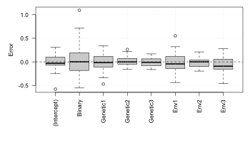

``` r
# summary stats for the computation time
comp_times <- sapply(
  sim_study, function(x) sapply(x, `[[`, "time")["elapsed", ])
summary(t(comp_times))
#>      start         opt_out_quick     opt_out    
#>  Min.   :0.00600   Min.   :10.8   Min.   :24.8  
#>  1st Qu.:0.00700   1st Qu.:13.9   1st Qu.:32.8  
#>  Median :0.00700   Median :15.0   Median :33.9  
#>  Mean   :0.00726   Mean   :15.6   Mean   :37.0  
#>  3rd Qu.:0.00700   3rd Qu.:16.5   3rd Qu.:39.1  
#>  Max.   :0.01300   Max.   :22.3   Max.   :94.7
summary(colSums(comp_times))
#>    Min. 1st Qu.  Median    Mean 3rd Qu.    Max. 
#>    37.3    47.5    50.5    52.6    55.0   108.9
```

## More Complicated Example

We consider a more complicated example in this section and use some of
the lower level functions in the package as an example. We start by
sourcing a file to get a function to simulate a data set with a maternal
effect and a genetic effect like in Mahjani et al. (2020):

``` r
# source the file to get the simulation function
source(system.file("gen-pedigree-data.R", package = "pedmod"))

# simulate a data set
set.seed(68167102)
dat <- sim_pedigree_data(n_families = 1000L)

# distribution of family sizes
par(mar = c(5, 4, 1, 1))
plot(table(sapply(dat$sim_data, function(x) length(x$y))), 
     xlab = "Family size", ylab = "Number of families", bty = "l")
```

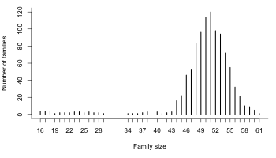

``` r
# total number of observations
sum(sapply(dat$sim_data, function(x) length(x$y)))
#> [1] 49734

# average event rate
mean(unlist(sapply(dat$sim_data, `[[`, "y")))
#> [1] 0.2386
```

As Mahjani et al. (2020), we have data families linked by three
generations but we only have data for the last generation. We illustrate
this with the first family in the simulated data set:

``` r
# this is the full family 
library(kinship2)
fam1 <- dat$sim_data[[1L]]
plot(fam1$pedAll)
```

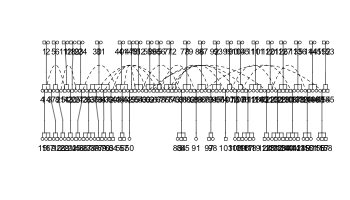

``` r
# here is the C matrix for the genetic effect
rev_img <- function(x, ...)
  image(x[, NROW(x):1], ...)
cl <- colorRampPalette(c("Red", "White", "Blue"))(101)

par(mar = c(2, 2, 1, 1))
rev_img(fam1$rel_mat, xaxt = "n", yaxt = "n", col = cl, 
        zlim = c(-1, 1))
```

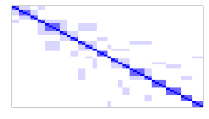

``` r
# the first part of the matrix is given below
with(fam1, 
     Matrix::Matrix(rel_mat[seq_len(min(10, NROW(rel_mat))), 
                            seq_len(min(10, NROW(rel_mat)))],
                    sparse = TRUE))
#> 10 x 10 sparse Matrix of class "dsCMatrix"
#>                                                               
#> 9  1.000 0.500 0.125 0.125 0.125 .     .     0.125 0.125 .    
#> 10 0.500 1.000 0.125 0.125 0.125 .     .     0.125 0.125 .    
#> 15 0.125 0.125 1.000 0.500 0.500 0.125 0.125 .     .     .    
#> 16 0.125 0.125 0.500 1.000 0.500 0.125 0.125 .     .     .    
#> 17 0.125 0.125 0.500 0.500 1.000 0.125 0.125 .     .     .    
#> 21 .     .     0.125 0.125 0.125 1.000 0.500 .     .     .    
#> 22 .     .     0.125 0.125 0.125 0.500 1.000 .     .     .    
#> 28 0.125 0.125 .     .     .     .     .     1.000 0.500 0.125
#> 29 0.125 0.125 .     .     .     .     .     0.500 1.000 0.125
#> 36 .     .     .     .     .     .     .     0.125 0.125 1.000

# here is the C matrix for the maternal effect
rev_img(fam1$met_mat, xaxt = "n", yaxt = "n", col = cl, 
        zlim = c(-1, 1))
```

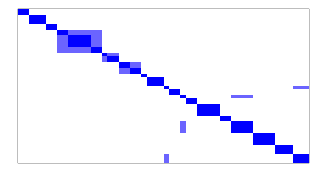

``` r
# the first part of the matrix is given below
with(fam1, 
     Matrix::Matrix(met_mat[seq_len(min(10, NROW(met_mat))), 
                            seq_len(min(10, NROW(met_mat)))],
                    sparse = TRUE))
#> 10 x 10 sparse Matrix of class "dsCMatrix"
#>                             
#> 9  1 1 . . . . . .   .   .  
#> 10 1 1 . . . . . .   .   .  
#> 15 . . 1 1 1 . . .   .   .  
#> 16 . . 1 1 1 . . .   .   .  
#> 17 . . 1 1 1 . . .   .   .  
#> 21 . . . . . 1 1 .   .   .  
#> 22 . . . . . 1 1 .   .   .  
#> 28 . . . . . . . 1.0 1.0 0.5
#> 29 . . . . . . . 1.0 1.0 0.5
#> 36 . . . . . . . 0.5 0.5 1.0

# each simulated family has such two matrices in addition to a design matrix
# for the fixed effects, X, and a vector with outcomes, y
str(fam1[c("X", "y")])
#> List of 2
#>  $ X: num [1:52, 1:3] 1 1 1 1 1 1 1 1 1 1 ...
#>   ..- attr(*, "dimnames")=List of 2
#>   .. ..$ : NULL
#>   .. ..$ : chr [1:3] "(Intercept)" "X1" ""
#>  $ y: Named logi [1:52] FALSE TRUE TRUE TRUE FALSE FALSE ...
#>   ..- attr(*, "names")= chr [1:52] "9" "10" "15" "16" ...
```

Then we perform the model estimation:

<!-- knitr::opts_knit$set(output.dir = ".") -->

<!-- knitr::load_cache("est_mod", path = "cache/README-") -->

``` r
# the true parameters are
dat$beta
#> (Intercept)          X1          X2 
#>        -1.0         0.3         0.2
dat$sc # the sigmas squared
#>  Genetic Maternal 
#>     0.50     0.33

# prepare the data to pass to the functions in the package
dat_arg <- lapply(dat$sim_data, function(x){
  # we need the following for each family: 
  #   y: the zero-one outcomes.
  #   X: the design matrix for the fixed effects. 
  #   scale_mats: list with the scale matrices for each type of effect.
  list(y = as.numeric(x$y), X = x$X,
       scale_mats = list(x$rel_mat, x$met_mat))
})

# create a C++ object
library(pedmod)
ll_terms <- pedigree_ll_terms(dat_arg, max_threads = 4L)

# get the starting values. This is very fast
y <- unlist(lapply(dat_arg, `[[`, "y"))
X <- do.call(rbind, lapply(dat_arg, `[[`, "X"))
start_fit <-  glm.fit(X, y, family = binomial("probit"))

# log likelihood at the starting values without random effects
-sum(start_fit$deviance) / 2     
#> [1] -26480
(beta <- start_fit$coefficients) # starting values for fixed effects 
#> (Intercept)          X1             
#>     -0.7342      0.2234      0.1349

# start at moderate sized scale parameters
sc <- rep(log(.2), 2)

# check log likelihood at the starting values. First we assign a function 
# to approximate the log likelihood and the gradient
fn <- function(par, seed = 1L, rel_eps = 1e-2, use_aprx = TRUE, 
               n_threads = 4L, indices = NULL, maxvls = 25000L, 
               method = 0L, use_sparse = FALSE, use_tilting = FALSE){
  set.seed(seed)
  -eval_pedigree_ll(
    ptr = if(use_sparse) ll_terms_sparse else ll_terms, par = par, 
    maxvls = maxvls, abs_eps = 0, rel_eps = rel_eps, minvls = 1000L, 
    use_aprx = use_aprx, n_threads = n_threads, indices = indices, 
    method = method, use_tilting = use_tilting)
}
gr <- function(par, seed = 1L, rel_eps = 1e-2, use_aprx = TRUE, 
               n_threads = 4L, indices = NULL, maxvls = 25000L, 
               method = 0L, use_sparse = FALSE, use_tilting = FALSE){
  set.seed(seed)
  out <- -eval_pedigree_grad(
    ptr = if(use_sparse) ll_terms_sparse else ll_terms, par = par, 
    maxvls = maxvls, abs_eps = 0, rel_eps = rel_eps, minvls = 1000L, 
    use_aprx = use_aprx, n_threads = n_threads, indices = indices, 
    method = method, use_tilting = use_tilting)
  structure(c(out), value = -attr(out, "logLik"), 
            n_fails = attr(out, "n_fails"), 
            std = attr(out, "std"))
}

# check output at the starting values
system.time(ll <- -fn(c(beta, sc)))
#>    user  system elapsed 
#>   2.151   0.005   0.553
ll # the log likelihood at the starting values
#> [1] -26042
#> attr(,"n_fails")
#> [1] 0
#> attr(,"std")
#> [1] 0.05963
system.time(gr_val <- gr(c(beta, sc)))
#>    user  system elapsed 
#>  19.940   0.015   5.067
gr_val # the gradient at the starting values
#> [1] 1894.83 -549.43 -235.73   47.21  -47.84
#> attr(,"value")
#> [1] 26042
#> attr(,"n_fails")
#> [1] 715
#> attr(,"std")
#> [1] 0.01845 0.25149 0.28043 0.20515 0.10778 0.11060

# standard deviation of the approximation
sd(sapply(1:25, function(seed) fn(c(beta, sc), seed = seed)))
#> [1] 0.09254

# we do the same for the gradient elements but only for a subset of the 
# log marginal likelihood elements
gr_hats <- sapply(
  1:25, function(seed) gr(c(beta, sc), seed = seed, indices = 0:99))
apply(gr_hats, 1, sd)
#> [1] 0.06953 0.11432 0.06340 0.02204 0.02467

# the errors are on similar magnitudes
gr(c(beta, sc), indices = 0:99)
#> [1] 197.674 -81.013  20.820   5.137  -6.452
#> attr(,"value")
#> [1] 2602
#> attr(,"n_fails")
#> [1] 73
#> attr(,"std")
#> [1] 0.005841 0.076801 0.084451 0.068685 0.032688 0.033749

# verify the gradient (may not be exactly equal due to MC error)
rbind(numDeriv = numDeriv::grad(fn, c(beta, sc), indices = 0:10), 
      pedmod   = gr(c(beta, sc), indices = 0:10))
#>           [,1]   [,2]  [,3]  [,4]   [,5]
#> numDeriv 28.00 -0.298 7.415 1.105 -1.071
#> pedmod   27.98 -0.331 7.402 1.113 -1.062

# optimize the log likelihood approximation
system.time(opt <- optim(c(beta, sc), fn, gr, method = "BFGS"))
#>    user  system elapsed 
#> 787.177   0.704 201.400
```

The output from the optimization is shown below:

``` r
print(-opt$value, digits = 8) # the maximum log likelihood
#> [1] -25823.021
opt$convergence               # check convergence
#> [1] 0

# compare the estimated fixed effects with the true values
rbind(truth     = dat$beta, 
      estimated = head(opt$par, length(dat$beta)))
#>           (Intercept)     X1     X2
#> truth          -1.000 0.3000 0.2000
#> estimated      -1.007 0.3059 0.1866

# compare estimated scale parameters with the true values
rbind(truth     = dat$sc, 
      estimated = exp(tail(opt$par, length(dat$sc))))
#>           Genetic Maternal
#> truth      0.5000   0.3300
#> estimated  0.5233   0.3643
```

### Computation in Parallel

The method scales reasonably well in the number of threads as shown
below:

``` r
library(microbenchmark)
microbenchmark(
  `fn (1 thread)`  = fn(c(beta, sc), n_threads = 1),
  `fn (2 threads)` = fn(c(beta, sc), n_threads = 2),
  `fn (4 threads)` = fn(c(beta, sc), n_threads = 4),
  `gr (1 thread)`  = gr(c(beta, sc), n_threads = 1),
  `gr (2 threads)` = gr(c(beta, sc), n_threads = 2),
  `gr (4 threads)` = gr(c(beta, sc), n_threads = 4),
  times = 1)
#> Unit: milliseconds
#>            expr     min      lq    mean  median      uq     max neval
#>   fn (1 thread)  2030.5  2030.5  2030.5  2030.5  2030.5  2030.5     1
#>  fn (2 threads)  1016.2  1016.2  1016.2  1016.2  1016.2  1016.2     1
#>  fn (4 threads)   531.1   531.1   531.1   531.1   531.1   531.1     1
#>   gr (1 thread) 18804.3 18804.3 18804.3 18804.3 18804.3 18804.3     1
#>  gr (2 threads)  9454.1  9454.1  9454.1  9454.1  9454.1  9454.1     1
#>  gr (4 threads)  4900.4  4900.4  4900.4  4900.4  4900.4  4900.4     1
```

### Using ADAM

We use stochastic gradient descent with the ADAM method (Kingma and Ba
2015) in this section. We define a function below to apply ADAM and use
it to estimate the model.

<!-- knitr::opts_knit$set(output.dir = ".") -->

<!-- knitr::load_cache("use_adam", path = "cache/README-") -->

``` r
#####
# performs stochastic gradient descent (using ADAM).
#
# Args:
#   par: starting value.
#   gr: function to evaluate the log marginal likelihood.
#   n_clust: number of observation.
#   n_blocks: number of blocks.
#   maxit: maximum number of iteration.
#   seed: seed to use.
#   epsilon, alpha, beta_1, beta_2: ADAM parameters.
#   maxvls: maximum number of samples to draw in each iteration. Thus, it 
#           needs maxit elements.
#   verbose: print output during the estimation.
#   ...: arguments passed to gr.
adam <- function(par, gr, n_clust, n_blocks, maxit = 10L,
                 seed = 1L, epsilon = 1e-8, alpha = .001, beta_1 = .9,
                 beta_2 = .999, maxvls = rep(10000L, maxit), 
                 verbose = FALSE, ...){
  grp_dummy <- (seq_len(n_clust) - 1L) %% n_blocks
  n_par <- length(par)
  m <- v <- numeric(n_par)
  fun_vals <- numeric(maxit)
  estimates <- matrix(NA_real_, n_par, maxit)
  i <- -1L

  for(k in 1:maxit){
    # sample groups
    indices <- sample.int(n_clust, replace = FALSE) - 1L
    blocks <- tapply(indices, grp_dummy, identity, simplify = FALSE)
    
    for(ii in 1:n_blocks){
      i <- i + 1L
      idx_b <- (i %% n_blocks) + 1L
      m_old <- m
      v_old <- v
      res <- gr(par, indices = blocks[[idx_b]], maxvls = maxvls[k])
      fun_vals[(i %/% n_blocks) + 1L] <-
        fun_vals[(i %/% n_blocks) + 1L] + attr(res, "value")
      res <- c(res)

      m <- beta_1 * m_old + (1 - beta_1) * res
      v <- beta_2 * v_old + (1 - beta_2) * res^2

      m_hat <- m / (1 - beta_1^(i + 1))
      v_hat <- v / (1 - beta_2^(i + 1))

      par <- par - alpha * m_hat / (sqrt(v_hat) + epsilon)
    }
    
    if(verbose){
      cat(sprintf("Ended iteration %4d. Running estimate of the function value is: %14.2f\n", 
                  k, fun_vals[k]))
      cat("Parameter estimates are:\n")
      cat(capture.output(print(par)), sep = "\n")
      cat("\n")
    }

    estimates[, k] <- par
  }

  list(par = par, estimates = estimates, fun_vals = fun_vals)
}

#####
# use the function
# assign the maximum number of samples we will use
maxit <- 100L
minvls <- 250L
maxpts <- formals(gr)$maxvls
maxpts_use <- exp(seq(log(2 * minvls), log(maxpts), length.out = maxit))

# show the maximum number of samples we use
par(mar = c(5, 4, 1, 1))
plot(maxpts_use, pch = 16, xlab = "Iteration number", bty = "l",
     ylab = "Maximum number of samples", ylim = range(0, maxpts_use))
```

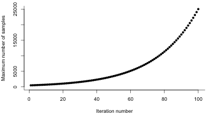

``` r
set.seed(1)
system.time(
  adam_res <- adam(c(beta, sc), gr = gr, n_clust = length(dat_arg), 
                   n_blocks = 10L, alpha = 1e-2, maxit = maxit, 
                   verbose = FALSE, maxvls = maxpts_use, 
                   minvls = minvls))
#>    user  system elapsed 
#> 739.817   0.747 192.194
```

The result is shown below.

``` r
print(-fn(adam_res$par), digits = 8) # the maximum log likelihood
#> [1] -25823.228
#> attr(,"n_fails")
#> [1] 0
#> attr(,"std")
#> [1] 0.066737305

# compare the estimated fixed effects with the true values
rbind(truth             = dat$beta,
      `estimated optim` = head(opt$par     , length(dat$beta)),
      `estimated ADAM`  = head(adam_res$par, length(dat$beta)))
#>                 (Intercept)     X1     X2
#> truth                -1.000 0.3000 0.2000
#> estimated optim      -1.007 0.3059 0.1866
#> estimated ADAM       -1.006 0.3068 0.1858

# compare estimated scale parameters with the true values
rbind(truth             = dat$sc, 
      `estimated optim` = exp(tail(opt$par     , length(dat$sc))), 
      `estimated ADAM`  = exp(tail(adam_res$par, length(dat$sc))))
#>                 Genetic Maternal
#> truth            0.5000   0.3300
#> estimated optim  0.5233   0.3643
#> estimated ADAM   0.5191   0.3653

# could possibly have stopped much earlier maybe. Dashed lines are final 
# estimates
par(mar = c(5, 4, 1, 1))
matplot(t(adam_res$estimates), type = "l", col = "Black", lty = 1, 
        bty = "l", xlab = "Iteration", ylab = "Estimate")
for(s in adam_res$par)
  abline(h = s, lty = 2)
```

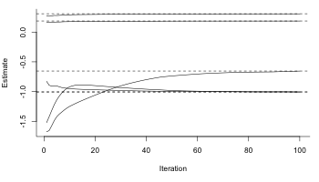

### The Multivariate Normal CDF Approximation

We compare the multivariate normal CDF approximation in this section
with the approximation from the mvtnorm package which uses the
implementation by Genz and Bretz (2002). The same algorithm is used but
the version in this package is re-written in C++ and differs slightly.
Moreover, we have implemented an approximation of the standard normal
CDF and its inverse which reduces the computation time as we will show
below.

We also compare our implementation of the minimax titling method
suggested by Botev (2017) with the implementation in the TruncatedNormal
package.

``` r
#####
# settings for the simulation study
library(mvtnorm)
library(pedmod)
library(microbenchmark)
set.seed(78459126)
n <- 5L         # number of variables to integrate out
rel_eps <- 1e-4 # the relative error to use

#####
# run the simulation study
sim_res <- replicate(expr = {
  # simulate covariance matrix and the upper bound
  S <- drop(rWishart(1L, 2 * n, diag(n) / 2 / n))
  u <- rnorm(n)
  
  # function to use pmvnorm
  use_mvtnorm <- function(rel_eps)
    mvtnorm::pmvnorm(
      upper = u, sigma = S, algorithm = GenzBretz(
      abseps = 0, releps = rel_eps, maxpts = 1e7))
  
  # function to use pmvnorm from TruncatedNormal
  use_trunc_norm <- function(n_sample)
    TruncatedNormal::pmvnorm(
      sigma = S, lb = rep(-Inf, n), ub = u, type = "qmc", B = n_sample)
  
  # function to use this package
  use_mvndst <- function(use_aprx = FALSE, method = 0L, use_tilting = TRUE)
    mvndst(lower = rep(-Inf, n), upper = u, mu = rep(0, n), 
           sigma = S, use_aprx = use_aprx, abs_eps = 0, rel_eps = rel_eps,
           maxvls = 1e7, method = method, use_tilting = use_tilting)

  # get a very precise estimate
  truth <- use_mvtnorm(rel_eps / 100)
  
  # computes the error with repeated approximations and compute the time it
  # takes
  n_rep <- 5L
  run_n_time <- function(expr){
    expr <- substitute(expr)
    ti <- get_nanotime()
    res <- replicate(n_rep, eval(expr))
    ti <- get_nanotime() - ti
    err <- (res - truth) / truth
    c(SE = sqrt(sum(err^2) / n_rep), time = ti / n_rep / 1e9)
  }
  
  mvtnorm_res                <- run_n_time(use_mvtnorm(rel_eps))
  
  n_sample <- attr(use_mvndst(TRUE, method = 0L, use_tilting = TRUE), "n_it")
  TruncatedNormal_res        <- run_n_time(use_trunc_norm(n_sample))
  
  mvndst_no_aprx_res_Korobov <- 
    run_n_time(use_mvndst(FALSE, method = 0L, use_tilting = FALSE))
  mvndst_w_aprx_res_Korobov  <- 
    run_n_time(use_mvndst(TRUE , method = 0L, use_tilting = FALSE))
  mvndst_no_aprx_res_Sobol   <- 
    run_n_time(use_mvndst(FALSE, method = 1L, use_tilting = FALSE))
  mvndst_w_aprx_res_Sobol    <- 
    run_n_time(use_mvndst(TRUE , method = 1L, use_tilting = FALSE))
  
  mvndst_no_aprx_res_Korobov_tilt <- 
    run_n_time(use_mvndst(FALSE, method = 0L, use_tilting = TRUE))
  mvndst_w_aprx_res_Korobov_tilt  <- 
    run_n_time(use_mvndst(TRUE , method = 0L, use_tilting = TRUE))
  mvndst_no_aprx_res_Sobol_tilt   <- 
    run_n_time(use_mvndst(FALSE, method = 1L, use_tilting = TRUE))
  mvndst_w_aprx_res_Sobol_tilt    <- 
    run_n_time(use_mvndst(TRUE , method = 1L, use_tilting = TRUE))

  # return 
  rbind(mvtnorm            = mvtnorm_res, 
        TruncatedNormal = TruncatedNormal_res,
        `no aprx; Korobov` = mvndst_no_aprx_res_Korobov, 
        `no aprx; Sobol` = mvndst_no_aprx_res_Sobol, 
        `w/ aprx; Korobov` = mvndst_w_aprx_res_Korobov,
        `w/ aprx; Sobol` = mvndst_w_aprx_res_Sobol,
        
        `no aprx; Korobov (tilt)` = mvndst_no_aprx_res_Korobov_tilt, 
        `no aprx; Sobol (tilt)` = mvndst_no_aprx_res_Sobol_tilt, 
        `w/ aprx; Korobov (tilt)` = mvndst_w_aprx_res_Korobov_tilt,
        `w/ aprx; Sobol (tilt)` = mvndst_w_aprx_res_Sobol_tilt)
}, n = 100, simplify = "array")
```

Box plots of the relative errors are shown below:

``` r
rowMeans(sim_res[, "SE", ])
#>                 mvtnorm         TruncatedNormal        no aprx; Korobov 
#>               2.800e-05               3.857e-05               3.160e-05 
#>          no aprx; Sobol        w/ aprx; Korobov          w/ aprx; Sobol 
#>               3.073e-05               3.042e-05               3.129e-05 
#> no aprx; Korobov (tilt)   no aprx; Sobol (tilt) w/ aprx; Korobov (tilt) 
#>               3.327e-05               2.803e-05               3.400e-05 
#>   w/ aprx; Sobol (tilt) 
#>               2.963e-05
par(mar = c(10, 4, 1, 1), bty = "l")
boxplot(t(sim_res[, "SE", ]), las = 2)
grid()
```

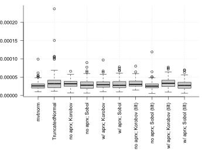

The new implementation is faster when the approximation is used:

``` r
rowMeans(sim_res[, "time", ])
#>                 mvtnorm         TruncatedNormal        no aprx; Korobov 
#>                0.014322                0.026260                0.006572 
#>          no aprx; Sobol        w/ aprx; Korobov          w/ aprx; Sobol 
#>                0.008566                0.002984                0.004380 
#> no aprx; Korobov (tilt)   no aprx; Sobol (tilt) w/ aprx; Korobov (tilt) 
#>                0.007645                0.007306                0.006610 
#>   w/ aprx; Sobol (tilt) 
#>                0.006236
par(mar = c(9, 4, 1, 1), bty = "l")
boxplot(t(sim_res[, "time", ]), log = "y", las = 2)
grid()
```

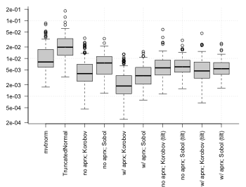

Next, we compare the methods with the first example from Botev (2017).
This is with a low probability case and we would expect the minimax
tilted version to perform better. We fix the number of samples with all
packages in this example.

``` r
# settings for the test like in Botev (2017)
library(mvtnorm)
library(pedmod)
library(microbenchmark)
ds <- c(3, 5, 10, 15, 20, 25)
n_sample <- 10000L

# run the simulation study
set.seed(15418038)
sim_res <- sapply(ds, \(d){
  S <- solve(diag(1/2, d) + 1/2)
  l <- rep(1/2, d)
  u <- rep(1, d)
  
  # function to use pmvnorm
  use_mvtnorm <- function(n_sample)
    mvtnorm::pmvnorm(lower = l, upper = u, sigma = S, algorithm = GenzBretz(
            abseps = 0, releps = 0, maxpts = n_sample))
  
  # function to use pmvnorm from TruncatedNormal
  use_trunc_norm <- function(n_sample)
    TruncatedNormal::pmvnorm(
      sigma = S, lb = l, ub = u, type = "qmc", B = n_sample)
  
  # function to use this package
  use_mvndst <- function(use_aprx = FALSE, method = 0L, use_tilting = TRUE)
    mvndst(lower = l, upper = u, mu = rep(0, d), 
           sigma = S, use_aprx = use_aprx, abs_eps = 0, rel_eps = 0,
           maxvls = n_sample, method = method, use_tilting = use_tilting, 
           minvls = n_sample)

  # get a very precise estimate
  truth <- use_trunc_norm(n_sample * 100L)
  
  # computes the error with repeated approximations and compute the time it
  # takes
  n_rep <- 25L
  run_n_time <- function(expr){
    expr <- substitute(expr)
    ti <- get_nanotime()
    res <- replicate(n_rep, eval(expr))
    ti <- get_nanotime() - ti
    err <- (res - truth) / truth
    c(SE = sqrt(sum(err^2) / n_rep), time = ti / n_rep / 1e9)
  }
  
  mvtnorm_res                <- run_n_time(use_mvtnorm(n_sample))
  
  TruncatedNormal_res        <- run_n_time(use_trunc_norm(n_sample))
  
  mvndst_no_aprx_res_Korobov <- 
    run_n_time(use_mvndst(FALSE, method = 0L, use_tilting = FALSE))
  mvndst_w_aprx_res_Korobov  <- 
    run_n_time(use_mvndst(TRUE , method = 0L, use_tilting = FALSE))
  mvndst_no_aprx_res_Sobol   <- 
    run_n_time(use_mvndst(FALSE, method = 1L, use_tilting = FALSE))
  mvndst_w_aprx_res_Sobol    <- 
    run_n_time(use_mvndst(TRUE , method = 1L, use_tilting = FALSE))
  
  mvndst_no_aprx_res_Korobov_tilt <- 
    run_n_time(use_mvndst(FALSE, method = 0L, use_tilting = TRUE))
  mvndst_w_aprx_res_Korobov_tilt  <- 
    run_n_time(use_mvndst(TRUE , method = 0L, use_tilting = TRUE))
  mvndst_no_aprx_res_Sobol_tilt   <- 
    run_n_time(use_mvndst(FALSE, method = 1L, use_tilting = TRUE))
  mvndst_w_aprx_res_Sobol_tilt    <- 
    run_n_time(use_mvndst(TRUE , method = 1L, use_tilting = TRUE))
  
  rbind(mvtnorm            = mvtnorm_res, 
        TruncatedNormal = TruncatedNormal_res,
        `no aprx; Korobov` = mvndst_no_aprx_res_Korobov, 
        `no aprx; Sobol` = mvndst_no_aprx_res_Sobol, 
        `w/ aprx; Korobov` = mvndst_w_aprx_res_Korobov,
        `w/ aprx; Sobol` = mvndst_w_aprx_res_Sobol,
        
        `no aprx; Korobov (tilt)` = mvndst_no_aprx_res_Korobov_tilt, 
        `no aprx; Sobol (tilt)` = mvndst_no_aprx_res_Sobol_tilt, 
        `w/ aprx; Korobov (tilt)` = mvndst_w_aprx_res_Korobov_tilt,
        `w/ aprx; Sobol (tilt)` = mvndst_w_aprx_res_Sobol_tilt)
}, simplify = "array")

dimnames(sim_res) <- 
  setNames(c(dimnames(sim_res)[1:2], list(ds)), 
           c("Method", "Metric", "Dimension"))
```

The relative errors plotted against the dimension is shown below:

``` r
# the errors for each method and dimension
sim_res[, "SE", ]
#>                          Dimension
#> Method                            3         5        10        15        20
#>   mvtnorm                 1.012e-06 1.712e-05 7.664e-04 2.452e-02 6.705e-01
#>   TruncatedNormal         4.236e-06 1.018e-05 4.698e-05 1.179e-04 1.790e-04
#>   no aprx; Korobov        6.860e-08 1.257e-06 2.049e-03 2.010e-02 2.959e-01
#>   no aprx; Sobol          5.200e-05 1.557e-04 3.787e-03 6.253e-02 5.190e-01
#>   w/ aprx; Korobov        9.988e-07 1.737e-06 2.248e-03 2.289e-02 3.701e-01
#>   w/ aprx; Sobol          4.537e-05 1.610e-04 3.892e-03 5.177e-02 3.766e-01
#>   no aprx; Korobov (tilt) 5.609e-08 3.648e-07 1.005e-05 2.075e-05 5.459e-05
#>   no aprx; Sobol (tilt)   3.181e-06 1.278e-05 5.804e-05 1.135e-04 3.107e-04
#>   w/ aprx; Korobov (tilt) 1.080e-07 9.765e-06 8.158e-05 2.548e-04       NaN
#>   w/ aprx; Sobol (tilt)   3.094e-06 1.724e-05 1.068e-04 2.642e-04       NaN
#>                          Dimension
#> Method                           25
#>   mvtnorm                 0.5974929
#>   TruncatedNormal         0.0001948
#>   no aprx; Korobov        0.6516720
#>   no aprx; Sobol          0.6469732
#>   w/ aprx; Korobov        0.5753175
#>   w/ aprx; Sobol          0.5478732
#>   no aprx; Korobov (tilt) 0.0001363
#>   no aprx; Sobol (tilt)   0.0003792
#>   w/ aprx; Korobov (tilt)       NaN
#>   w/ aprx; Sobol (tilt)         NaN

# plot the errors
par(mar = c(5, 5, 1, 1), cex = .8)
matplot(ds, t(sim_res[, "SE", ]), type = "p", log = "y", 
        pch = 1:dim(sim_res)[1], xlab = "Dimension", ylab = "Relative error", 
        col = "black", bty = "l")
matlines(ds, t(sim_res[, "SE", ]), col = "black", lty = 2)
legend("bottomright", bty = "n", pch = 1:dim(sim_res)[1], 
       legend = dimnames(sim_res)[[1]])
grid()
```

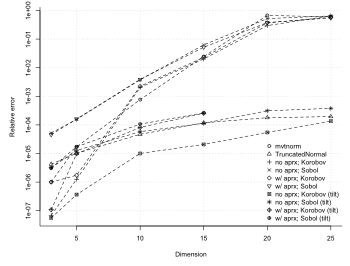

A similar plot for the average estimation time is shown below.

``` r
# the computation time for each method and dimension
sim_res[, "time", ]
#>                          Dimension
#> Method                            3         5       10       15       20
#>   mvtnorm                 0.0016968 0.0034048 0.011953 0.030556 0.040841
#>   TruncatedNormal         0.0075952 0.0133393 0.028566 0.041474 0.059217
#>   no aprx; Korobov        0.0017022 0.0029622 0.006218 0.009558 0.012630
#>   no aprx; Sobol          0.0014821 0.0023708 0.004806 0.007277 0.009623
#>   w/ aprx; Korobov        0.0006049 0.0009757 0.002172 0.003400 0.004657
#>   w/ aprx; Sobol          0.0006649 0.0009490 0.001963 0.002958 0.003946
#>   no aprx; Korobov (tilt) 0.0038047 0.0065049 0.013953 0.021544 0.027965
#>   no aprx; Sobol (tilt)   0.0029725 0.0049595 0.010142 0.015520 0.020228
#>   w/ aprx; Korobov (tilt) 0.0031465 0.0054787 0.011697 0.020903 0.008602
#>   w/ aprx; Sobol (tilt)   0.0024868 0.0042239 0.008568 0.015074 0.006777
#>                          Dimension
#> Method                          25
#>   mvtnorm                 0.050014
#>   TruncatedNormal         0.075672
#>   no aprx; Korobov        0.015902
#>   no aprx; Sobol          0.011915
#>   w/ aprx; Korobov        0.005935
#>   w/ aprx; Sobol          0.005059
#>   no aprx; Korobov (tilt) 0.034456
#>   no aprx; Sobol (tilt)   0.025515
#>   w/ aprx; Korobov (tilt) 0.010555
#>   w/ aprx; Sobol (tilt)   0.008713

# plot the computation time
par(mar = c(5, 5, 1, 1), cex = .8)
matplot(ds, t(sim_res[, "time", ]), type = "p", log = "y", 
        pch = 1:dim(sim_res)[1], xlab = "Dimension", ylab = "Time", 
        col = "black", bty = "l")
matlines(ds, t(sim_res[, "time", ]), col = "black", lty = 2)
legend("bottomright", bty = "n", pch = 1:dim(sim_res)[1], 
       legend = dimnames(sim_res)[[1]])
grid()
```

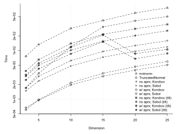

## References

<div id="refs" class="references csl-bib-body hanging-indent">

<div id="ref-Botev17" class="csl-entry">

Botev, Z. I. 2017. “The Normal Law Under Linear Restrictions: Simulation
and Estimation via Minimax Tilting.” *Journal of the Royal Statistical
Society: Series B (Statistical Methodology)* 79 (1): 125–48.
<https://doi.org/10.1111/rssb.12162>.

</div>

<div id="ref-Genz02" class="csl-entry">

Genz, Alan, and Frank Bretz. 2002. “Comparison of Methods for the
Computation of Multivariate t Probabilities.” *Journal of Computational
and Graphical Statistics* 11 (4): 950–71.
<https://doi.org/10.1198/106186002394>.

</div>

<div id="ref-Kingma15" class="csl-entry">

Kingma, Diederik P., and Jimmy Ba. 2015. “Adam: A Method for Stochastic
Optimization.” *CoRR* abs/1412.6980.

</div>

<div id="ref-Liu17" class="csl-entry">

Liu, Xing-Rong, Yudi Pawitan, and Mark S. Clements. 2017. “Generalized
Survival Models for Correlated Time-to-Event Data.” *Statistics in
Medicine* 36 (29): 4743–62. <https://doi.org/10.1002/sim.7451>.

</div>

<div id="ref-Mahjani20" class="csl-entry">

Mahjani, Behrang, Lambertus Klei, Christina M. Hultman, et al. 2020.
“Maternal Effects as Causes of Risk for Obsessive-Compulsive Disorder.”
*Biological Psychiatry* 87 (12): 1045–51.
<https://doi.org/10.1016/j.biopsych.2020.01.006>.

</div>

<div id="ref-Pawitan04" class="csl-entry">

Pawitan, Y., M. Reilly, E. Nilsson, S. Cnattingius, and P. Lichtenstein.
2004. “Estimation of Genetic and Environmental Factors for Binary Traits
Using Family Data.” *Statistics in Medicine* 23 (3): 449–65.
<https://doi.org/10.1002/sim.1603>.

</div>

</div>
